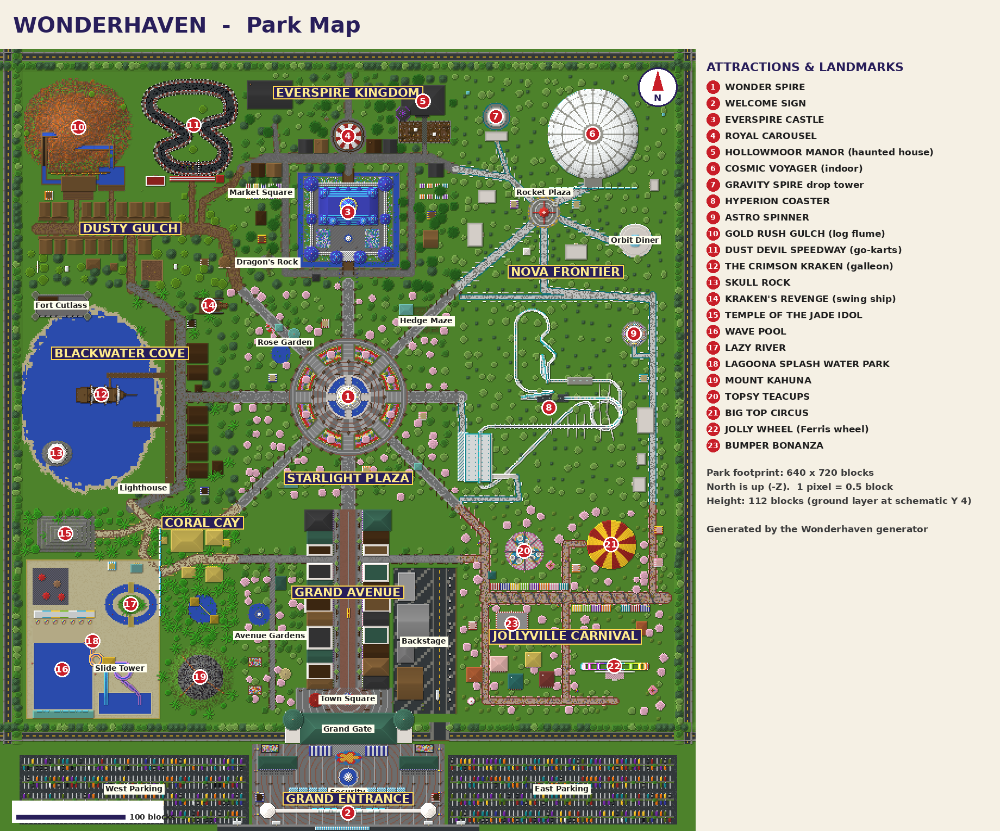
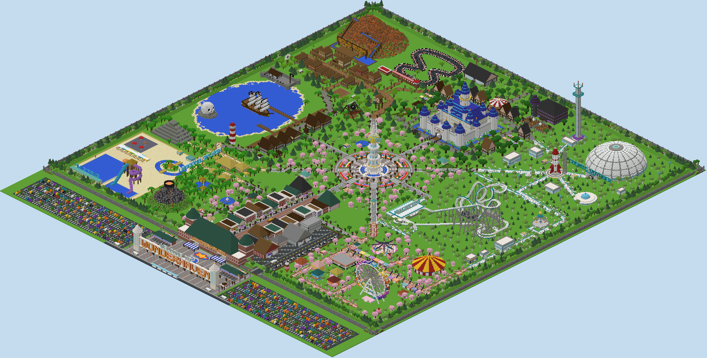

# Wonderhaven: a theme park schematic for Litematica

Wonderhaven is a complete Minecraft theme park in the spirit of Disneyland and Universal Studios. It is
shipped as real **Litematica `.litematic` schematics** that you can load straight into the mod: one file
for the whole park, plus one file per land if you want to work on a single area.





## Downloads

| File | What it contains |
| --- | --- |
| [`output/Wonderhaven_Complete_Park.litematic`](output/Wonderhaven_Complete_Park.litematic) | **The whole park** in one schematic, split into 10 named sub-regions (one per land) |
| [`output/sections/`](output/sections) | The same 10 areas as separate schematics, for building or pasting one land at a time |
| [`output/overview_map.png`](output/overview_map.png) | Top-down park map with numbered attractions, a legend, a compass and a scale bar |
| [`output/overview_map_plain.png`](output/overview_map_plain.png) | The same map without labels (1 pixel = 0.5 block) |
| [`output/isometric_view.png`](output/isometric_view.png) | 3D isometric render of the full park |
| [`output/stats.json`](output/stats.json) | Exact sizes, offsets, block counts and the most-used materials |

## Specifications

| | |
| --- | --- |
| **Total size** | **640 × 112 × 720 blocks** (X × Y × Z), which is a 460,800 m² footprint |
| **Blocks placed** | **1,123,828** non-air blocks, using 335 block types (856 distinct block states) |
| **Ground level** | The grass/path layer is at **Y = 4 inside the schematic**. Layers 0–3 hold pools, moats and lagoon beds that sit below ground. |
| **Tallest points** | Gravity Spire drop tower (107 blocks above ground, counting its crown and beacon), Wonder Spire (96), Everspire Castle's main spire (87), Jolly Wheel (68), Hyperion's lift hill (64) |
| **Minecraft version** | 1.20.1 or newer. The file carries data version 3465, and newer Litematica builds upgrade it automatically. |
| **Litematica format** | Schematic version 6. Every block state is checked against the 1.20.1 block registry, and every file is read back with an independent reader (litemapy) to confirm the blocks match. |
| **Block choice** | Survival-obtainable blocks only. There is no command block, barrier, structure block or light block. |

## Major attractions

| # | Attraction | Land | Details |
| --- | --- | --- | --- |
| 1 | **Hyperion** (giant roller coaster) | Nova Frontier | 64-block lift hill, 62° first drop into a tunnel, 2 vertical loops, a corkscrew, a 75° overbanked turn, an airtime hill, a second lit tunnel, a banked helix, A-frame and column supports, a raised station with a switchback queue, a parked 6-car train, giant HYPERION letters and an exit footbridge over the track |
| 2 | **Jolly Wheel** (Ferris wheel) | Jollyville Carnival | 60-block-diameter rainbow wheel with 18 gondolas (windows and seats), 18 spokes per side, lit rims, twin A-frame legs and a boarding platform |
| 3 | **Gold Rush Gulch** (log flume) | Dusty Gulch | A 40-block layered-mesa mountain. The flume has a station with log boats, a 30-block lift, a tunnel through the peak, cascades, a trestle section, a 45° big drop and a splash pool with a viewing deck. |
| 4 | **Gravity Spire** (drop tower) | Nova Frontier | 100-block tower with ride carriages at the top and bottom, a lit crown and a working beacon that shines a cyan beam into the night sky |
| 5 | **Topsy Teacups** (spinning teacups) | Jollyville Carnival | 3 turntables with 9 colored cups (seats and wheels), a giant teapot centerpiece and string lights on a pergola |
| 6 | **Royal Carousel** | Everspire Kingdom | 24 horses on brass poles at alternating heights, a mirrored center drum, a striped canopy, a gold-trimmed valance and lanterns |
| 7 | **Lagoona Splash** (water park) | Coral Cay | Wave pool with a beach and a wave-machine house, a lazy river around a tiki island, a slide tower with 2 enclosed tube slides and a speed slide, a splash pool, a kids' mushroom splash pad, cabanas, loungers and lifeguard towers |
| 8 | **Hollowmoor Manor** (family-friendly haunted house) | Everspire Kingdom | Three-storey gothic mansion with a witch-hat tower, a ride track and buggies inside, a library, a ballroom of glass ghosts, cobwebs, a graveyard and jack-o'-lanterns |
| 9 | **Dust Devil Speedway** (go-karts) | Dusty Gulch | Spline-shaped circuit with curbs, gravel traps, tire walls, a checkered start/finish gantry, 6 karts, a pit garage, a grandstand and a control tower |
| 10 | **Cosmic Voyager** (huge indoor ride) | Nova Frontier | 84-block-wide double-shelled dome lit by a starfield, with an indoor dark coaster (lift, drops, banked turns, helix), a light-ring launch tunnel, floating planets including a ringed one, an indoor station and a portal entrance |

More rides and landmarks: the **Wonder Spire** central landmark (a 96-block tower topped by a glowing glass-and-gold globe), the
walk-through **Everspire Castle** (moat, drawbridge, 15 towers and a banquet hall), **Kraken's Revenge** swinging pirate ship,
**The Crimson Kraken** three-masted galleon, **Skull Rock**, **Fort Cutlass**, a lighthouse, **Big Top Circus**,
**Bumper Bonanza** bumper cars, the **Temple of the Jade Idol**, **Mount Kahuna** volcano, a rocket landmark, the **Orbit Diner**
flying-saucer restaurant, the **Astro Spinner** rocket ride, a hedge maze, a dragon sculpture, midway games and the Main Street trolley.

## Themed lands

| Land | Architecture and landscaping | Attractions | Food, shops and services |
| --- | --- | --- | --- |
| **Everspire Kingdom** (Medieval Fantasy) | Calcite castle with blue cone roofs and gold finials, a moat, half-timbered Tudor village, market square and a well | Castle walk-through, Royal Carousel, Hollowmoor Manor, Dragon's Rock | Dragon's Feast Hall, Sweet Shoppe, Wizard Wands, Royal Tailor, Armory, Bakery, Toy Maker, Enchanted Gifts, Turkey Legs and Royal Tarts stands, restroom, info |
| **Coral Cay** (Tropical Adventure Island) | Bamboo and thatch huts, stilt huts by a jungle pond, a rope bridge, palms and tiki torches | Lagoona Splash water park, Temple of the Jade Idol, Mount Kahuna volcano | Tiki Tumba Grill, Tiki Treasures, Island Outfitters, Surf Shack, Pineapple Whip, 2 restrooms, info |
| **Nova Frontier** (Futuristic Sci-Fi) | White and cyan architecture, glass, sea-lantern lighting, glowing kinetic sculptures, Rocket Plaza | Hyperion, Cosmic Voyager, Gravity Spire, Astro Spinner | Orbit Diner, Galactic Goods, Robo Arcade, Star Traders, Hyperion Outpost, Cosmic Cones, Space Dogs, Starport Snacks, 2 restrooms, info, ride maintenance bay |
| **Dusty Gulch** (Wild West) | False-front saloon street with covered boardwalks, a water tower, a windmill, covered wagons, a corral, hay bales and cacti | Gold Rush Gulch log flume, Dust Devil Speedway | Rusty Spur saloon, Pecos BBQ, General Store, Sheriff, Bank, Hotel, Blacksmith, Barber, Assay Office, Trading Post, Candy Co., Sarsaparilla and Churro carts, restroom, info |
| **Jollyville Carnival** (Cartoon Carnival) | Candy-colored toon houses, a giant cupcake and ice-cream sculptures, balloon bunches, striped awnings and string lights | Jolly Wheel, Topsy Teacups, Big Top Circus, Bumper Bonanza, 15 midway game booths | Cotton Candy, Corn Dogs, Funnel Cake, Candy Apples, Giggle House, Toy Box, Joke Shop and more, restroom, info |
| **Blackwater Cove** (Pirate Cove) | Lagoon with beaches, timber harbor town, boardwalk, piers on pilings, barrels and crates | Crimson Kraken galleon, Kraken's Revenge, Skull Rock, Fort Cutlass, lighthouse | Salty Barnacle tavern, Captain's Loot, Map Maker, Rope & Anchor, Davy's Locker, Harbor Master, Grog & Juice, Fish & Chips, restroom, info |

## Park infrastructure

- **Massive entrance gates.** A Victorian gate station spans the park berm. It has two walk-through tunnels, two 54-block clock towers and a glowing WONDERHAVEN marquee made of redstone lamps powered by redstone blocks.
- **Giant welcome sign.** A 158-block-wide sign reading WELCOME TO WONDERHAVEN in lit lamps sits between two pylons. Its back reads SEE YOU SOON.
- **Ticketing and security.** Two Victorian ticket offices have 12 windows and stanchion queues. There are 12 bag-check tents with metal-detector arches, and covered turnstile lanes at both tunnels.
- **Main street (Grand Avenue).** 22 Victorian shops and restaurants (Emporium, Confectionery, Cinema, Fire Station No. 1, City Hall and more), with furnished interiors, awnings and window boxes. It also has a trolley line with a trolley car, a Town Square with a flagpole and bandstand, and the Avenue Gardens with a pond and gazebo.
- **Restaurants and food.** Every land has at least one sit-down restaurant and several food kiosks.
- **Restrooms and info.** 11 restroom buildings (separate sides, stalls, sinks) and 8 guest-information booths.
- **Street furniture.** About 690 themed street lamps (each land has its own lamp design), plus benches with armrests, trash cans and planters along every path.
- **Staff and maintenance.** A fenced backstage compound has the Cast Member Center offices, the Central Maintenance Shop, Wardrobe & Costuming, a parade float barn, utility carts, a truck and a service road through a service gate. There are also a ride maintenance bay, a go-kart pit garage and a perimeter service road.
- **Gardens, fountains and ponds.** The central reflecting pool has 16 lit jets. There are tiered fountains, a rose garden pond, a hedge maze, floral beds, a floral star at the gate, and a landscaped berm with trees around the park.
- **Central landmark.** The Wonder Spire sits at the hub of 8 radial avenues that lead to every land.
- **Parking and transit.** Two parking lots with parked cars, light poles and tree islands, and a tram stop with shelters and a shuttle tram.
- **Nighttime lighting.** Lanterns, sea lanterns, glowstone, froglights, end rods, lit lamps and candles throughout. Building interiors are lit, rim lights run around the Ferris wheel, and the drop tower has a beacon.

## How to load it in Litematica

1. **Install the mods.** Install [Litematica](https://www.curseforge.com/minecraft/mc-mods/litematica) and its library
   [MaLiLib](https://www.curseforge.com/minecraft/mc-mods/malilib) for your Minecraft version (Fabric, 1.20.1 or newer).
2. **Copy the files.** Copy `Wonderhaven_Complete_Park.litematic` (and the `sections` files if you want them) into your
   schematics folder:
   - Windows: `%appdata%\.minecraft\schematics\`
   - macOS: `~/Library/Application Support/minecraft/schematics/`
   - Linux: `~/.minecraft/schematics/`

   Create the `schematics` folder if it does not exist. If you use a launcher such as Prism or CurseForge, use that instance's `.minecraft` folder.
3. **Find a spot.** Choose a flat area of at least **640 × 720 blocks** (a superflat world is easiest).
4. **Load the schematic.** In game, press **M** to open the Litematica menu and choose **Load Schematics**. Select `Wonderhaven_Complete_Park`
   and click **Load Schematic**. A placement is created at your feet.
5. **Position the placement.** Open **Schematic Placements** and click **Configure** on the Wonderhaven placement.
   - Set the **origin Y** to *(your ground level − 4)*. This puts the park's grass layer exactly on your ground, and the 4
     layers below it hold the pool basins, the moat and the lagoon bed, which you dig into the ground. For example, if
     your grass is at Y = 64, use origin Y = 60.
   - The default superflat world only has 3 layers above bedrock, which is not deep enough for the pools. Instead, create a
     superflat world with the preset `minecraft:bedrock,8*minecraft:dirt,minecraft:grass_block;minecraft:plains`. Its
     grass is at Y = −55, so use origin Y = −59.
   - The origin is the park's **north-west corner**. The entrance faces south (+Z).
6. **Work one land at a time if you like.** In the placement's **Sub-regions** list you can switch each land on or off,
   which is handy when you only want to render or build one area.
7. **Build it.**
   - *Survival:* use **Material List** (in the placement menu) to see what to gather, and **Easy Place** mode to place
     blocks exactly as the schematic shows. Use the **render layers** option to show one Y level at a time.
   - *Creative:* switch the tool to **Paste Schematic in World** (Ctrl + scroll changes the tool mode) and use it on the
     placement. The park is over 1.1 million blocks, so pasting land by land (one sub-region at a time, or the section
     files) is much kinder to your game and server.
8. **Check your work.** Use Litematica's **Schematic Verifier** to find missing or wrong blocks.

### Section files

Each file in `output/sections/` covers one land, using the same vertical frame as the full park (grass layer at
Y = 4). To line a section up with the full park, place its origin at the full park's origin plus the offset below.

| File | Size (X × Y × Z) | Offset from park origin (X, Y, Z) | Blocks |
| --- | --- | --- | --- |
| `Wonderhaven_01_Dusty_Gulch_Wild_West` | 220 × 112 × 220 | 0, 0, 0 | 130,053 |
| `Wonderhaven_02_Everspire_Kingdom_Medieval` | 200 × 112 × 220 | 220, 0, 0 | 150,863 |
| `Wonderhaven_03_Nova_Frontier_North_SciFi` | 220 × 112 × 220 | 420, 0, 0 | 113,169 |
| `Wonderhaven_04_Blackwater_Cove_Pirates` | 220 × 112 × 200 | 0, 0, 220 | 126,776 |
| `Wonderhaven_05_Starlight_Plaza_Central_Hub` | 200 × 112 × 200 | 220, 0, 220 | 70,793 |
| `Wonderhaven_06_Nova_Frontier_South_Hyperion` | 220 × 112 × 200 | 420, 0, 220 | 82,512 |
| `Wonderhaven_07_Coral_Cay_Tropical_Waterpark` | 220 × 112 × 200 | 0, 0, 420 | 108,300 |
| `Wonderhaven_08_Grand_Avenue_Main_Street` | 200 × 112 × 200 | 220, 0, 420 | 121,673 |
| `Wonderhaven_09_Jollyville_Carnival_Cartoon` | 220 × 112 × 200 | 420, 0, 420 | 88,957 |
| `Wonderhaven_10_Grand_Entrance_Plaza` | 640 × 112 × 100 | 0, 0, 620 | 130,732 |

## Things to know

- **Rides are static.** Litematica stores blocks, so trains, gondolas, log boats, karts, teacups and the swinging ship are
  decorative block models posed mid-ride. No entities (minecarts, boats, armor stands) are included.
- **Water** is stored as source blocks in pools, the moat, the lagoon, the flume channel and the slides. The flume's drop and the
  slides are built as stepped channels with tall walls, so the cascades created by flowing water stay inside them.
- **Lit lettering.** The WONDERHAVEN marquees use `redstone_lamp[lit=true]` backed by redstone blocks, so they stay lit.
  The drop tower's beacon sits on its own 3 × 3 iron pyramid.
- **Signs** carry text such as attraction names, wait times, shop names and restroom labels. The text is stored in 1.20 format,
  and newer game versions convert it on load.
- **Leaves** are stored with `persistent=true`, so the hedges, bushes and palm fronds will not decay.
- **Connections.** Fence, wall, pane and stair connections are pre-computed the way vanilla does it, so Easy Place
  and the verifier agree with the schematic.
- **Supported blocks.** An integrity pass checks that every attachable block has support: lanterns, signs, ladders,
  flowers, cacti, cocoa, carpets, doors and so on. Each one gets a support or is removed, so nothing pops off when
  the game updates it. Coconuts hang on palm trunks, string-light lanterns hang from chain "wires", and stand-alone
  info signs sit on wooden posts.

## Regenerating or modifying the park

The park is produced by a Python generator (no Minecraft needed), so you can change it and rebuild it:

```sh
cd minecraft-amusement-park
pip install numpy pillow            # litemapy is optional; when installed it is used to verify the output
python3 -m generator.generate --iso # writes everything into ./output (about 2 minutes)
```

| Path | Role |
| --- | --- |
| `generator/nbt.py`, `generator/litematic.py` | Dependency-free NBT writer and Litematica exporter (bit-packed block states, palettes, tile entities, preview image) |
| `generator/world.py` | Voxel world with a palette, plus a rotatable local "builder" that also rotates block states |
| `generator/post.py` | Computes fence, wall, pane and iron-bar connections and stair corner shapes the way vanilla does |
| `generator/track.py` | Roller-coaster designer (straights, pitch arcs, banked turns, helices, loops, corkscrews, hills, Hermite connectors) with supports and tunnels |
| `generator/buildings.py`, `generator/decor.py`, `generator/rides.py` | Architecture and roofs, furnished interiors, street furniture, trees, and flat rides |
| `generator/lands/*.py` | One module per land, plus the hub, main street, entrance and the perimeter |
| `generator/validate.py` | Registry check of every block state, and the litemapy round-trip |
| `generator/render.py`, `generator/export.py` | Maps, isometric render and file export |
