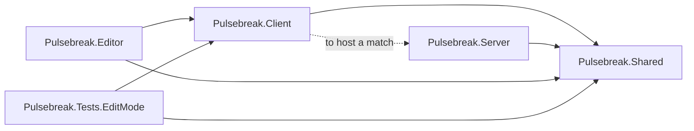
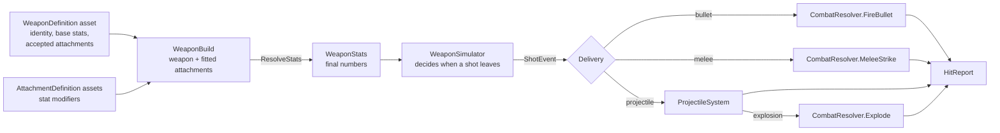
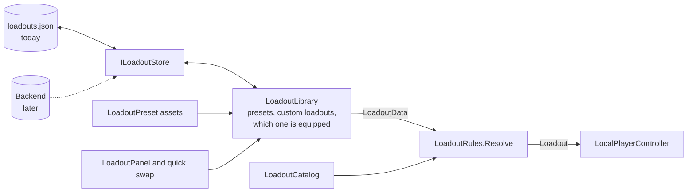
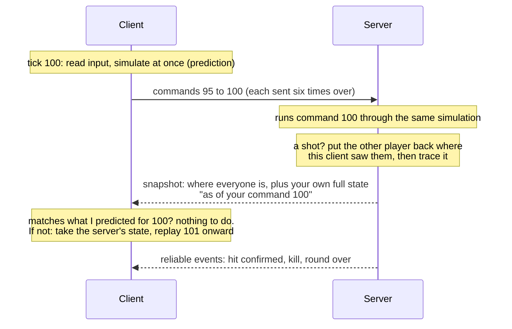
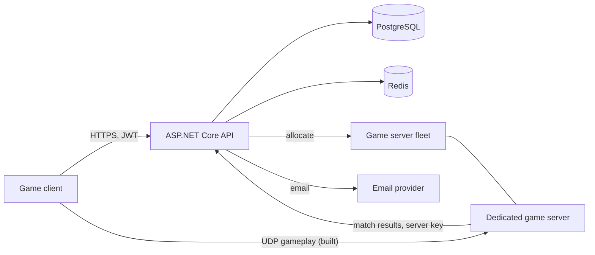

# Pulsebreak architecture

Pulsebreak (working title) is a fast, competitive multiplayer FPS for PC: tight gunplay and loadouts from modern military shooters, short rounds and snappy movement from arena shooters. This document covers the technology choices, how the repository is laid out, and how the systems connect. The phased plan is in [ROADMAP.md](ROADMAP.md).

Phases 1 to 4 exist as code today: movement, the weapon system, loadouts saved locally, a firing range to try them in, and online 1v1 duels on a server that owns the match. Sections that describe later phases say so.

## Technology choices

| Area | Choice | Status |
| --- | --- | --- |
| Engine | Unity 6, URP, C# | In use |
| Input | Unity Input System | In use |
| UI | UI Toolkit (UXML + USS) | In use |
| Netcode | Written for this game: server-authoritative, over UDP | In use |
| Backend API | ASP.NET Core | Recommended, starts in Phase 5 |
| Database | PostgreSQL | Phase 5 |
| Sessions and queues | Redis | Phase 5 and 6 |
| Game servers | The game itself, started with `-batchmode -nographics -server` | Runs today; containers and a fleet come with matchmaking |

### Netcode: written for this game

The game needs a server that owns the truth, clients that predict their own movement and shooting so input feels instant, and lag compensation so a shot that was on target on your screen counts. Three libraries were considered:

| | Netcode for GameObjects | Photon Fusion 2 | Fish-Networking |
| --- | --- | --- | --- |
| Client-side prediction with rollback | No. Offers "client anticipation", which does not roll back and replay ([Unity docs](https://docs.unity3d.com/Packages/com.unity.netcode.gameobjects@2.7/manual/latency-performance.html)) | Built in | Built in |
| Lag-compensated hit detection | Not provided | Built in | A paid Pro feature ([FishNet docs](https://fish-networking.gitbook.io/docs/guides/features/lag-compensation)) |
| Cost | Free | Free tier, then priced by concurrent users | Free core, paid Pro tier |

**Decision: none of them. The netcode is part of this project.** The simulation was built from the start so that it could be rewound and replayed ([The simulation core](#the-simulation-core)), which is the hard part a library would otherwise provide. What was left to write was a transport, a wire format and the server. In return:

- there is no per-player fee and no account with a third party;
- nothing is a black box: when a shot does not register, every line that decided it is in this repository;
- the whole thing runs in a test, with a real server and real clients, on a simulated bad connection ([How it is tested](#how-it-is-tested)).

The cost is owning it. What a library would have brought and this does not yet have is listed under [Known limits](#known-limits).

### Backend: ASP.NET Core

ASP.NET Core over Node.js, for three reasons:

- **One language.** The game is C#. Request and response types, validation rules and the weapon stat tables the server uses to check hits can be shared with the backend instead of written twice and kept in sync by hand.
- **What accounts need is built in.** JWT authentication, rate limiting middleware, data validation and password hashing libraries are first-party or standard.
- **Performance headroom.** Matchmaking and leaderboards are CPU-bound work where it does well.

PostgreSQL holds everything durable (accounts, inventories, loadouts, stats, match history, ratings). Redis holds everything short-lived (refresh-token sessions, rate-limit counters, matchmaking queues, party and lobby state).

## Repository layout

```
pulsebreak/
├── README.md               How to open and play the current build
├── docs/
│   ├── ARCHITECTURE.md     This file
│   └── ROADMAP.md          The phased plan
├── game/                   The Unity 6 project (client and dedicated server builds)
└── backend/                ASP.NET Core API (arrives in Phase 5)
```

### Inside the Unity project

```
game/
├── Packages/manifest.json
├── ProjectSettings/
└── Assets/_Project/
    ├── Shared/             Gameplay rules. Runs on client and server.
    │   ├── Simulation/       Tick constants, input commands, layers, seeded random,
    │   │                     and PlayerSimulation: one player, stepped a tick at a time
    │   ├── Movement/         Character motor, its config asset and state
    │   ├── Weapons/          Weapon and attachment assets, stats, simulator, inventory,
    │   │                     projectiles, combat resolution, catalog, validation
    │   ├── Loadouts/         Stored loadout format, rules, presets, utility items,
    │   │                     perk sets, the utility belt, catalog, validation
    │   ├── Combat/           Health, hitboxes, damage types
    │   ├── Net/              Packets, sockets (UDP and in-process), the connection,
    │   │                     and every message that crosses the wire
    │   ├── Match/            Duel rules and state, the arena as data, player health,
    │   │                     and the interfaces the server reaches the world through
    │   └── Unity/            Those interfaces implemented with Unity physics
    ├── Client/             Everything a player sees, hears or touches.
    │   ├── Controls/         Input System reader
    │   ├── Player/           Local player loop (offline and online), camera, rig assembly
    │   ├── Net/              The client's side of a match: connection, prediction,
    │   │                     interpolation; and how the other player is drawn
    │   ├── Duel/             The duel scene: main menu, hosting and joining, match HUD
    │   ├── Weapons/          First-person weapon models, tracers, projectiles, explosions
    │   ├── Audio/            Sound playback and placeholder synthesis
    │   ├── Loadouts/         The loadout library and where it is saved
    │   ├── UI/               HUD, pause menu and loadout screen logic
    │   ├── Settings/         Player settings
    │   ├── Visuals/          Prototype geometry and materials
    │   └── FiringRange/      The range: layout, targets, stats
    ├── Server/             The authority: game server, players, lag compensation, duel rules
    │   └── Unity/            The component that runs a server inside Unity
    ├── Editor/             Editor tooling (Project Doctor)
    ├── Content/            Data assets: weapons, attachments, utility, perks, presets, movement
    ├── Resources/          UI layout, styles and base materials loaded by path
    ├── Rendering/          URP pipeline assets
    ├── Scenes/             Duel (the main menu and online play) and FiringRange
    └── Tests/EditMode/     Unit tests for the simulation, the netcode and the content
```

Each top-level code folder is its own assembly, and the compiler enforces the direction of dependencies:



`Shared` references nothing of ours. It cannot reach the HUD, the camera or the input devices, which is what keeps it runnable on a headless server. `Server` references only `Shared`: it knows nothing about the client and can be built without it. `Client` references `Server` for one reason, so a player can host a match from the menu. That reference is the first thing to cut if ranked play should only ever run on servers you operate.

## The simulation core

The rule everything else follows from: **gameplay advances in fixed ticks, from input commands, into plain state.**

- **Fixed ticks.** Movement and weapons step 60 times a second regardless of frame rate (`SimConstants`).
- **Input commands.** Each tick the simulation reads one `PlayerInputCmd`: move axes, view angles and a set of held buttons. It never reads the keyboard, the mouse or the clock.
- **Plain state.** `MotorState` and `WeaponState` are structs holding everything about a character and their gun. They can be copied, stored and restored. `PlayerSimulation` bundles the motor, the weapons and the utility belt of one player, and `PlayerSimState` is all of its state in one object that can be saved, compared, sent and put back.
- **Seeded randomness.** Bullet spread comes from `DeterministicRandom`, seeded by weapon and shot number, never from `UnityEngine.Random`.
- **Presentation listens, never talks back.** Camera, weapon model, audio and HUD read simulation state and subscribe to its events. Nothing in the simulation depends on them.

Those five properties are exactly what server authority and client-side prediction require: the server runs the same code on the same commands, and a client rewinds to a past state and replays its commands when the server corrects it. The firing range, a client predicting its own player and the server all step the same `PlayerSimulation`.

### One frame of the local player


`LocalPlayerController` owns this loop. The diagram shows it offline, where it is also the authority. Online the same loop runs as a prediction, described under [Networking](#networking). Position is blended between the last two ticks so motion is smooth at any frame rate, while view angles come straight from the current frame's mouse input, so aiming has no added latency.

## The weapon system

A weapon is data, and the path from an asset to a hit is the same for all thirty of them:



- **`WeaponDefinition`** is one asset per weapon: an id, a class, a loadout slot, base stats, the attachments it accepts, and the proportions and sound of its placeholder model. **`WeaponCatalog`** lists them all; a weapon exists for the game once it is in the catalog.
- **`AttachmentDefinition`** is one asset per attachment: a slot and a list of stat changes such as "magazine size x1.34". Because the changes are relative, one suppressor asset fits every weapon that lists it.
- **`WeaponBuild`** is a weapon plus at most one attachment per slot. `ResolveStats` copies the base stats, applies additions and then multipliers, and clamps the result. It is the only place attachment effects become numbers.
- **`WeaponStats`** is a plain class, not a Unity object, so the simulator, the tests and later the server and backend can use it without assets.
- **`WeaponSimulator`** handles every fire mode (automatic, semi-automatic, burst, charge), both reload styles, spread, recoil and timing. It emits `ShotEvent`s and never touches physics.
- **`WeaponInventory`** holds one simulator per slot, so ammo is remembered while a weapon is put away, and times the switch between them.
- **`CombatResolver`** and **`ProjectileSystem`** turn shots into `HitReport`s: bullets that can pierce, melee sweeps, and projectiles with gravity, bounces, fuses and explosions that respect cover.

Adding a weapon or an attachment is therefore an asset and a catalog entry. Code changes only when a weapon needs a behaviour that does not exist yet.

## Loadouts

A loadout is a primary, a secondary, a melee weapon, two utility items and a perk set. It exists in two forms, and one set of rules converts between them.



- **`LoadoutData`** is the stored form: a name and nothing but ids. It holds no asset references, so it can be written to a file, sent to a server or kept in a database, and still be read after content has changed. A `LoadoutCollection` wraps a player's loadouts with a format version and the id of the equipped one.
- **`Loadout`** is the playable form: real `WeaponBuild`s, `UtilityDefinition`s and a `PerkSetDefinition`.
- **`LoadoutRules`** is the only way from one to the other. `Resolve` never fails: an unknown weapon, a weapon in the wrong slot, an attachment that does not fit, the same utility item twice or a missing perk set is replaced with a default and noted. The game server runs the same function on every loadout a client sends, so a client cannot equip something illegal by editing its save or its packets.
- **`LoadoutLibrary`** is what the UI talks to: create, rename, replace, delete, equip. It keeps presets read-only, limits custom loadouts to ten, sanitises every edit, and saves after every change.
- **`ILoadoutStore`** is where saving happens. `LocalFileLoadoutStore` writes JSON to the save folder, swapping the file in whole so a crash cannot leave half of one, and sets an unreadable file aside instead of overwriting it.

### Why this is "local first" and not "local only"

Moving loadouts to the backend means writing one more `ILoadoutStore`. Nothing else changes, because the pieces sync needs are already in the format:

- every loadout has a permanent unique id, so two devices can tell "the same loadout" from "two loadouts with the same name";
- every loadout carries the time it was last changed, which is what decides the winner when two devices disagree;
- the collection has a version number, so the layout can change without breaking old saves;
- a server runs `LoadoutRules` on whatever it receives, so it never has to trust the client. The game server already does.

### Utility items and perk sets

- A **`UtilityDefinition`** is a throwable: how many are carried, the wind-up and cooldown of a throw, and the projectile stats of the thrown object. Those are the same stats weapons use, so a thrown grenade and a launched one go through the same `ProjectileSystem`.
- **`UtilityBelt`** simulates the two slots per tick, like `WeaponSimulator` does a weapon. While a throw is winding up the weapon in hand cannot fire.
- A **`PerkSetDefinition`** is a bundle of passive effects: stat modifiers applied to every weapon after its attachments, a movement speed multiplier, and utility bonuses.

### Where each requirement lives

| Requirement | Class | Notes |
| --- | --- | --- |
| Sprint, slide, crouch, jump, mantle, lean | `PlayerMotor` | Tuned by a `MovementConfig` asset |
| ADS, recoil patterns, spread, fire modes, reload | `WeaponSimulator` | Runs on `WeaponStats` |
| Hitscan and projectile weapons | `CombatResolver`, `ProjectileSystem` | Chosen per weapon by its `ballistics` stat |
| Damage falloff, headshot multipliers | `DamageCalculator`, `Hitbox` | One function used for feedback and authority |
| Attachments | `AttachmentDefinition`, `WeaponBuild` | Sights, barrels, magazines, grips, stocks, lasers |
| Weapon switching | `WeaponInventory` | Primary, secondary and melee slots |
| Premade default loadouts | `LoadoutPreset`, `LoadoutCatalog` | Six ship with the game |
| Create, edit, rename, save custom loadouts | `LoadoutLibrary`, `LoadoutPanel` | Saved through `ILoadoutStore` |
| Two utility items, one perk set | `UtilityBelt`, `UtilityDefinition`, `PerkSetDefinition` | |
| Quick-swap loadouts between rounds | `HudController` quick swap, `ClientSession.SetLoadout` | In a match the server applies it at the next round |
| Loadouts synced across devices | `ILoadoutStore` | Backend store arrives with accounts |
| Hit markers, damage numbers, crosshair, optics | `HudController` | Damage numbers toggle in the pause menu |
| New content without code | Definition assets and catalogs | `LoadoutValidator` checks all of it |
| Server-authoritative play | `GameServer` | Clients send inputs and nothing else that counts |
| Client-side prediction | `ClientSession`, `PlayerSimulation` | Rollback and replay on disagreement |
| Lag compensation (hit rewind) | `LagCompensator` | Capped at 0.3 s |
| Interpolation of other players | `ClientSession.TryGetView`, `RemotePlayerView` | |
| Server checks hits, speed, fire rate, ammo | `GameServer` | By running the simulation itself |
| 1v1 duels, best of five | `DuelMatch` | Rounds to win, timers and health are in `DuelConfig` |
| Kill feed, health, score, round clock | `DuelUi` | |

## Networking

One process is the **server**. It holds the only copy of the match that counts. Each player's game is a **client**: it sends what its player is pressing and draws what the server says happened. A client is never asked what it hit, where it is or how much ammunition it has.



### The pieces

| Layer | Class | Job |
| --- | --- | --- |
| Socket | `INetSocket`: `UdpSocket`, `MemoryNetwork`, `ConditionedSocket` | Send and receive datagrams. The in-process and bad-connection versions exist so the rest can be tested |
| Connection | `NetConnection` | Numbers packets and acknowledges them, measures the round trip, and carries two kinds of message: unreliable (sent once) and reliable (resent until acknowledged, delivered in order) |
| Wire format | `NetMessages`, `NetWriter`, `NetReader` | Every message, written and read in one place. The reader never trusts its input |
| Server | `GameServer`, `ServerPlayer`, `LagCompensator`, `DuelMatch` | The authority |
| Client | `ClientSession` | Connection, prediction, interpolation, and events for the HUD |
| World | `IGameWorld`, `ICharacterBody` | How the server reaches physics. `UnityGameWorld` in the game, a stand-in in tests |

### Joining

A client asks to join; the server answers with a number worked out from the client's address; the client sends it back. Only then does the server create anything for that client. The reply to a request is never larger than the request, and an unanswered request costs the server no memory, so the handshake cannot be used to flood a third party or to exhaust the server with made-up addresses. Every packet after that carries the token the two agreed on.

### Prediction

Each tick the client turns its input into a `PlayerInputCmd`, rounds it to exactly what will survive the trip (`NetMessages.Quantize`), simulates it immediately and sends it. Each packet carries the last six commands, so a lost packet costs nothing.

The server runs each command once through the same `PlayerSimulation` and includes the result in its next snapshot to that player, together with the number of the command it had reached. The client kept its own state after every command. If the two agree, nothing happens. If they differ, the client takes the server's state, replays the commands it has sent since, silently, and slides the view to the corrected position over about a tenth of a second.

In the test harness, with client and server stepping identical code, the count of corrections after a round has started is zero, on a clean connection and at 200 ms with 5% packet loss. In Unity it will not be exactly zero: two machines do not always round a float the same way, and the position check allows 2 mm before it calls something a disagreement. The match HUD shows a running count (F3).

### Seeing the other player

Snapshots arrive 60 times a second. The other player is drawn slightly in the past, about two snapshots back and further when the connection is uneven, so there are nearly always two known positions to blend between. If nothing newer has arrived the body carries on in a straight line for up to a tenth of a second rather than freeze.

### Lag compensation

Because the other player is drawn in the past, a client aiming straight at them is aiming at where they were. Each command therefore carries the server tick its player was looking at. When that command fires an instant shot, `LagCompensator` puts every other body back where it was at that tick, the server traces the shot, and puts them forward again. The rewind is capped at 0.3 s, which bounds the advantage a very poor connection can get.

Measured in the harness, firing at a strafing target at about 170 ms round trip: 39 of 39 shots hit with the rewind, 4 of 39 without it.

Projectiles are not rewound. They are launched when the server runs the command, fly in server time, and everyone is shown the same flight.

### What the server refuses

There is no separate anti-cheat pass; the server simply does not ask the client for anything it could lie about.

| A modified client tries to | What happens |
| --- | --- |
| Move faster | The server moves the player itself, from the buttons held |
| Run its game faster than real time | Each player earns one command per server tick, with a small allowance saved up for hiccups. Extra commands wait, then are dropped. Tested: a client running at double speed travels no further |
| Fire faster, or without ammunition | The server runs the weapon itself |
| Claim a hit | Clients do not report hits. The server traces every shot, with spread drawn from the same seed |
| Rewind further than it should | The view tick is clamped to the last 0.3 s |
| Equip something it should not have | `LoadoutRules` replaces it, as it would on loading a save |
| Send malformed or hostile packets | `NetReader` fails closed: a bad length, a number that is not a number or a truncated message is dropped. Tested with several thousand random packets and messages |
| Learn the opponent's ammunition or cooldowns | Only a player's own snapshot carries their full state |

What this does not stop is a client that reads its own memory to see through walls or aim for the player. That needs a different kind of defence and is noted in the roadmap.

### The duel

`DuelMatch` runs on the server: a warm-up while one player waits, then rounds of countdown, live play and a short pause, until someone has won three. Players swap ends each round. A round that runs out of time goes to whoever has more health. Leaving forfeits. The server sends the whole `MatchState` whenever it changes.

The countdown is the one place prediction needs care. The server ignores movement and fire until the countdown ends, and a command sent now arrives a little later, so the client releases its own controls when a command sent *now* would arrive after the countdown, not when its own screen says zero. Both players start moving at the same server tick whatever their ping.

A loadout change sent mid-round is checked and held, and applied when the server next places that player.

### One process, two worlds

When a player hosts from the menu, a server and a client run in the same process and their bodies must never touch. The server's capsules and hitboxes live on their own two physics layers (`GameLayers.ServerCharacter`, `ServerHitbox`), the level's collision is shared, and server code switches the masks while it runs. The hosting player's client still talks to its own server through a UDP socket and is predicted and corrected like any other.

### How it is tested

`Shared`, `Server` and `ClientSession` never touch a scene, so the tests run a real `GameServer` and real `ClientSession`s in one process, joined by `MemoryNetwork`, with `ConditionedSocket` adding delay, jitter, loss and duplicates. That covers connecting, prediction on good and bad connections, lag compensation with and without the rewind, a best-of-five played through, round timers, projectiles and utility, loadout checks, a speed hack, random and hostile packets, leaving, timeouts and a full server. One test does the same over real UDP sockets on the loopback address.

The tests that need the stand-in physics world are not in the Unity project, because that world replaces `UnityEngine`. The ones in `Tests/EditMode` cover the layers below: packet buffers, the connection (including 40% loss and sequence wrap-around), every message, and the arena's symmetry and spawn points.

### Known limits

- **No encryption.** Packets are not encrypted or authenticated beyond the connection token. Fine on a LAN and for testing; before public play the token should come from the backend's login and the traffic should be encrypted.
- **No NAT traversal or relay.** To host over the internet the host forwards a UDP port. Dedicated servers on public addresses, which matchmaking will use, do not have this problem.
- **IPv4 only.**
- **Snapshots are sent whole**, about 0.5 KB sixty times a second per player. Fine for a duel; team modes will want delta compression and a lower rate.
- **A player's own projectiles appear when the server launches them**, one round trip after the trigger. The shot sound and recoil are immediate.
- **Players pass through each other.** It keeps prediction independent of where the opponent is.
- **Sound has no position yet.** Other players' shots are only quieter with distance.

## Backend and services (Phases 5 onward)



- **Accounts.** Sign-up with email, username and password. Passwords are hashed with Argon2id. A verification link or code is emailed, and ranked play is refused until it is used. Login returns a short-lived JWT access token and a rotating refresh token stored in Redis. Password reset is by emailed single-use token.
- **Abuse protection.** Per-IP and per-account rate limits, lockout with backoff after repeated failed logins, server-side validation of every request body.
- **Player data.** Profile, level and XP, currency, unlocked weapons and cosmetics, saved loadouts, lifetime stats, match history and ranked rating, all in PostgreSQL and loaded on login so they follow the account across devices. Loadouts arrive through a backend `ILoadoutStore`, in the `LoadoutCollection` format they already use on disk.
- **Matchmaking.** Players or parties join a Redis queue per playlist. A matchmaker groups them by rating and latency, asks the fleet for a server, and hands each client a connection ticket.
- **Trust boundary.** Clients never report results. The dedicated server reports the match outcome to the API using its own credential, and the API awards XP, updates stats and adjusts ratings.
- **Social.** Friends, parties and invites, block and report.

## Project conventions

- Data that designers tune lives in ScriptableObject assets under `Content/`, never as constants in code.
- Physics layers are referenced by index through `GameLayers`: `Character` (8) for movement capsules, `Hitbox` (9) for per-body-part damage colliders, and `ServerCharacter` (10) and `ServerHitbox` (11) for the server's copies. Bullets hit the world and hitboxes; movement collides with the world.
- Units are metres, seconds and degrees.
- Levels, props and weapon models are built from code (`GreyboxKit`, `RangeLayout`, `ArenaLayout`, `ViewModelBuilder`) because there is no art yet. They are stand-ins for authored scenes and prefabs, which replace them as content arrives.
