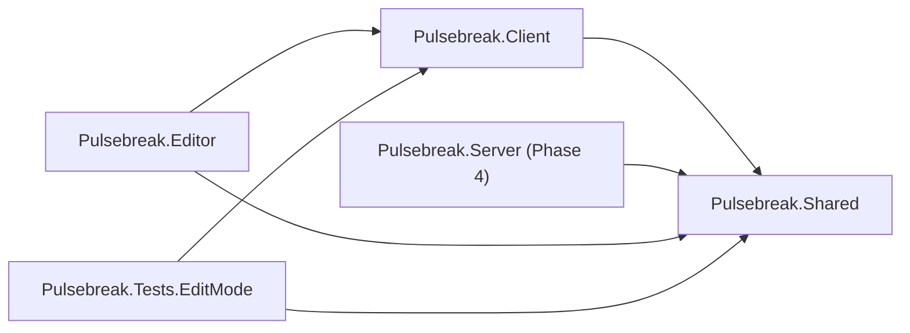
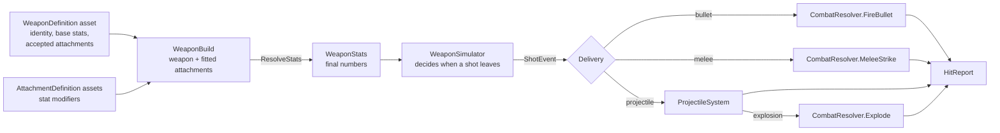
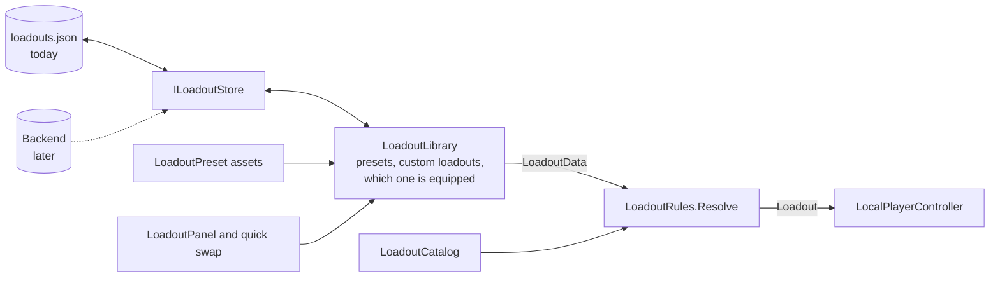
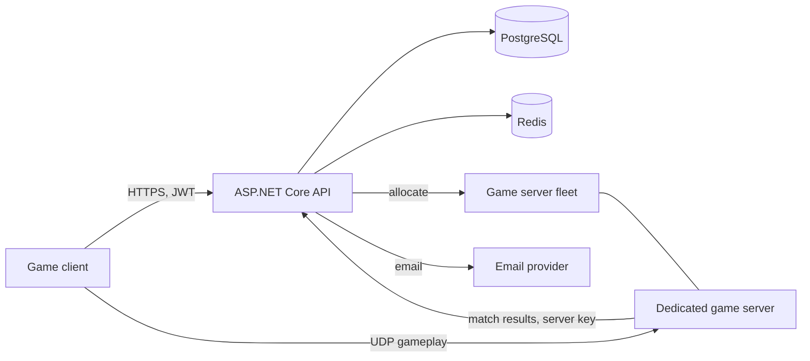

# Pulsebreak architecture

Pulsebreak (working title) is a fast, competitive multiplayer FPS for PC: tight gunplay and loadouts from modern military shooters, short rounds and snappy movement from arena shooters. This document covers the technology choices, how the repository is laid out, and how the systems connect. The phased plan is in [ROADMAP.md](ROADMAP.md).

Phases 1 to 3 exist as code today: movement, the weapon system, loadouts saved locally, and a firing range to try them in. Sections that describe later phases say so.

## Technology choices

| Area | Choice | Status |
| --- | --- | --- |
| Engine | Unity 6, URP, C# | In use |
| Input | Unity Input System | In use |
| UI | UI Toolkit (UXML + USS) | In use |
| Netcode | Photon Fusion 2 in dedicated-server mode | Recommended, needs your decision before Phase 4 |
| Backend API | ASP.NET Core | Recommended, starts in Phase 5 |
| Database | PostgreSQL | Phase 5 |
| Sessions and queues | Redis | Phase 5 and 6 |
| Game servers | Headless Unity builds in Linux containers | Phase 4 onward |

### Netcode: Photon Fusion 2

The game needs a server that owns the truth, clients that predict their own movement and shooting so input feels instant, and lag compensation so a shot that was on target on your screen counts. The three candidates differ mainly in how much of that comes built in.

| | Netcode for GameObjects | Photon Fusion 2 | Fish-Networking |
| --- | --- | --- | --- |
| Client-side prediction with rollback | No. Offers "client anticipation", which does not roll back and replay ([Unity docs](https://docs.unity3d.com/Packages/com.unity.netcode.gameobjects@2.7/manual/latency-performance.html)) | Built in, tick-based | Built in |
| Lag-compensated hit detection | Not provided; you write it | Built in | Raycast lag compensation is a paid Pro feature ([FishNet docs](https://fish-networking.gitbook.io/docs/guides/features/lag-compensation)) |
| Dedicated server mode | Yes | Yes | Yes |
| Cost | Free | Free tier, then priced by concurrent users | Free core, paid Pro tier |
| Source available | Yes | Core is closed | Yes |

**Recommendation: Fusion 2.** It is the only one of the three that ships prediction, re-simulation and lag-compensated hitboxes together, and those are the hardest parts of an FPS to get right. With Netcode for GameObjects both would have to be written from scratch. Fish-Networking is the runner-up: its prediction is solid and free, and the hit-rewind buffer it charges for is something this project could write itself.

Things to weigh before committing:

- **Cost grows with players.** Fusion is priced by peak concurrent users, and a dedicated server also connects to Photon as a client, so each running match adds to the count. One third-party summary lists a free tier of 100 concurrent users and paid tiers above that ([pricing summary](https://crux.supercraft.host/blog/photon-fusion-pricing-2026/)). I could not load Photon's own pricing page from this environment, so check [photonengine.com](https://www.photonengine.com/Fusion) before deciding.
- **You still pay for server hosting.** Photon provides relay and matchmaking plumbing, not the machines the matches run on.
- **Lock-in is limited by design.** All gameplay rules live in plain C# classes that know nothing about the netcode library (see [The simulation core](#the-simulation-core)). Switching library later means rewriting the thin layer that feeds them, not the movement or the guns.

If cost matters more than time, choose Fish-Networking and the roadmap gains a few days in Phase 4 for a hitbox rewind buffer.

### Backend: ASP.NET Core

ASP.NET Core over Node.js, for three reasons:

- **One language.** The game is C#. Request and response types, validation rules and the weapon stat tables the server uses to check hits can be shared with the backend instead of written twice and kept in sync by hand.
- **What accounts need is built in.** JWT authentication, rate limiting middleware, data validation and password hashing libraries are first-party or standard.
- **Performance headroom.** Matchmaking and leaderboards are CPU-bound work where it does well.

PostgreSQL holds everything durable (accounts, inventories, loadouts, stats, match history, ratings). Redis holds everything short-lived (refresh-token sessions, rate-limit counters, matchmaking queues, party and lobby state).

## Repository layout

```
pulsebreak/
├── README.md               How to open and play the current build
├── docs/
│   ├── ARCHITECTURE.md     This file
│   └── ROADMAP.md          The phased plan
├── game/                   The Unity 6 project (client and dedicated server builds)
└── backend/                ASP.NET Core API (arrives in Phase 5)
```

### Inside the Unity project

```
game/
├── Packages/manifest.json
├── ProjectSettings/
└── Assets/_Project/
    ├── Shared/             Gameplay rules. Runs on client and server.
    │   ├── Simulation/       Tick constants, input commands, layers, seeded random
    │   ├── Movement/         Character motor, its config asset and state
    │   ├── Weapons/          Weapon and attachment assets, stats, simulator, inventory,
    │   │                     projectiles, combat resolution, catalog, validation
    │   ├── Loadouts/         Stored loadout format, rules, presets, utility items,
    │   │                     perk sets, the utility belt, catalog, validation
    │   └── Combat/           Health, hitboxes, damage types
    ├── Client/             Everything a player sees, hears or touches.
    │   ├── Controls/         Input System reader
    │   ├── Player/           Local player loop, camera, rig assembly
    │   ├── Weapons/          First-person weapon models, tracers, projectiles, explosions
    │   ├── Audio/            Sound playback and placeholder synthesis
    │   ├── Loadouts/         The loadout library and where it is saved
    │   ├── UI/               HUD, pause menu and loadout screen logic
    │   ├── Settings/         Player settings
    │   ├── Visuals/          Prototype geometry and materials
    │   └── FiringRange/      The range: layout, targets, stats
    ├── Server/             Authoritative match logic (arrives in Phase 4)
    ├── Editor/             Editor tooling (Project Doctor)
    ├── Content/            Data assets: weapons, attachments, utility, perks, presets, movement
    ├── Resources/          UI layout, styles and base materials loaded by path
    ├── Rendering/          URP pipeline assets
    ├── Scenes/
    └── Tests/EditMode/     Unit tests for the simulation and the content
```

Each top-level code folder is its own assembly, and the compiler enforces the direction of dependencies:



`Shared` references nothing of ours. It cannot reach the HUD, the camera or the input devices, which is what keeps it runnable on a headless server. `Client` and `Server` never reference each other.

## The simulation core

The rule everything else follows from: **gameplay advances in fixed ticks, from input commands, into plain state.**

- **Fixed ticks.** Movement and weapons step 60 times a second regardless of frame rate (`SimConstants`).
- **Input commands.** Each tick the simulation reads one `PlayerInputCmd`: move axes, view angles and a set of held buttons. It never reads the keyboard, the mouse or the clock.
- **Plain state.** `MotorState` and `WeaponState` are structs holding everything about a character and their gun. They can be copied, stored and restored.
- **Seeded randomness.** Bullet spread comes from `DeterministicRandom`, seeded by weapon and shot number, never from `UnityEngine.Random`.
- **Presentation listens, never talks back.** Camera, weapon model, audio and HUD read simulation state and subscribe to its events. Nothing in the simulation depends on them.

Those five properties are exactly what server authority and client-side prediction require: the server can run the same code on the same commands, and a client can rewind to a past state and replay its commands when the server corrects it.

### One frame of the local player


`LocalPlayerController` owns this loop. Position is blended between the last two ticks so motion is smooth at any frame rate, while view angles come straight from the current frame's mouse input, so aiming has no added latency.

## The weapon system

A weapon is data, and the path from an asset to a hit is the same for all thirty of them:



- **`WeaponDefinition`** is one asset per weapon: an id, a class, a loadout slot, base stats, the attachments it accepts, and the proportions and sound of its placeholder model. **`WeaponCatalog`** lists them all; a weapon exists for the game once it is in the catalog.
- **`AttachmentDefinition`** is one asset per attachment: a slot and a list of stat changes such as "magazine size x1.34". Because the changes are relative, one suppressor asset fits every weapon that lists it.
- **`WeaponBuild`** is a weapon plus at most one attachment per slot. `ResolveStats` copies the base stats, applies additions and then multipliers, and clamps the result. It is the only place attachment effects become numbers.
- **`WeaponStats`** is a plain class, not a Unity object, so the simulator, the tests and later the server and backend can use it without assets.
- **`WeaponSimulator`** handles every fire mode (automatic, semi-automatic, burst, charge), both reload styles, spread, recoil and timing. It emits `ShotEvent`s and never touches physics.
- **`WeaponInventory`** holds one simulator per slot, so ammo is remembered while a weapon is put away, and times the switch between them.
- **`CombatResolver`** and **`ProjectileSystem`** turn shots into `HitReport`s: bullets that can pierce, melee sweeps, and projectiles with gravity, bounces, fuses and explosions that respect cover.

Adding a weapon or an attachment is therefore an asset and a catalog entry. Code changes only when a weapon needs a behaviour that does not exist yet.

## Loadouts

A loadout is a primary, a secondary, a melee weapon, two utility items and a perk set. It exists in two forms, and one set of rules converts between them.



- **`LoadoutData`** is the stored form: a name and nothing but ids. It holds no asset references, so it can be written to a file, sent to a server or kept in a database, and still be read after content has changed. A `LoadoutCollection` wraps a player's loadouts with a format version and the id of the equipped one.
- **`Loadout`** is the playable form: real `WeaponBuild`s, `UtilityDefinition`s and a `PerkSetDefinition`.
- **`LoadoutRules`** is the only way from one to the other. `Resolve` never fails: an unknown weapon, a weapon in the wrong slot, an attachment that does not fit, the same utility item twice or a missing perk set is replaced with a default and noted. The same function will run on the server, so a client cannot equip something illegal by editing its save or its requests.
- **`LoadoutLibrary`** is what the UI talks to: create, rename, replace, delete, equip. It keeps presets read-only, limits custom loadouts to ten, sanitises every edit, and saves after every change.
- **`ILoadoutStore`** is where saving happens. `LocalFileLoadoutStore` writes JSON to the save folder, swapping the file in whole so a crash cannot leave half of one, and sets an unreadable file aside instead of overwriting it.

### Why this is "local first" and not "local only"

Moving loadouts to the backend means writing one more `ILoadoutStore`. Nothing else changes, because the pieces sync needs are already in the format:

- every loadout has a permanent unique id, so two devices can tell "the same loadout" from "two loadouts with the same name";
- every loadout carries the time it was last changed, which is what decides the winner when two devices disagree;
- the collection has a version number, so the layout can change without breaking old saves;
- the server will run `LoadoutRules` on whatever it receives, so it never has to trust the client.

### Utility items and perk sets

- A **`UtilityDefinition`** is a throwable: how many are carried, the wind-up and cooldown of a throw, and the projectile stats of the thrown object. Those are the same stats weapons use, so a thrown grenade and a launched one go through the same `ProjectileSystem`.
- **`UtilityBelt`** simulates the two slots per tick, like `WeaponSimulator` does a weapon. While a throw is winding up the weapon in hand cannot fire.
- A **`PerkSetDefinition`** is a bundle of passive effects: stat modifiers applied to every weapon after its attachments, a movement speed multiplier, and utility bonuses.

### Where each requirement lives

| Requirement | Class | Notes |
| --- | --- | --- |
| Sprint, slide, crouch, jump, mantle, lean | `PlayerMotor` | Tuned by a `MovementConfig` asset |
| ADS, recoil patterns, spread, fire modes, reload | `WeaponSimulator` | Runs on `WeaponStats` |
| Hitscan and projectile weapons | `CombatResolver`, `ProjectileSystem` | Chosen per weapon by its `ballistics` stat |
| Damage falloff, headshot multipliers | `DamageCalculator`, `Hitbox` | One function used for feedback and authority |
| Attachments | `AttachmentDefinition`, `WeaponBuild` | Sights, barrels, magazines, grips, stocks, lasers |
| Weapon switching | `WeaponInventory` | Primary, secondary and melee slots |
| Premade default loadouts | `LoadoutPreset`, `LoadoutCatalog` | Six ship with the game |
| Create, edit, rename, save custom loadouts | `LoadoutLibrary`, `LoadoutPanel` | Saved through `ILoadoutStore` |
| Two utility items, one perk set | `UtilityBelt`, `UtilityDefinition`, `PerkSetDefinition` | |
| Quick-swap loadouts | `HudController` quick swap | Stands in for between-round selection |
| Loadouts synced across devices | `ILoadoutStore` | Backend store arrives with accounts |
| Hit markers, damage numbers, crosshair, optics | `HudController` | Damage numbers toggle in the pause menu |
| New content without code | Definition assets and catalogs | `LoadoutValidator` checks all of it |

## How this becomes multiplayer (Phase 4)

Nothing in `Shared` changes shape. The pieces move:

| Today (offline) | Networked |
| --- | --- |
| `LocalPlayerController` runs the tick loop from `Update` | The netcode library's tick callback runs it, on the server and on the owning client |
| `PlayerInputReader` hands commands to the local loop | Commands are also sent to the server |
| `MotorState` and `WeaponState` are kept locally | They are the networked state: the server sends them, the client restores them and replays unconfirmed commands |
| A loadout reaches the player straight from the library | It travels as `LoadoutData`; the server runs `LoadoutRules.Resolve` on it and both sides end up with the same stats |
| `UtilityBelt` runs in the player's loop | It is part of the predicted, server-checked player state, like the weapon |
| `ProjectileSystem` runs in the player's loop | The server runs it; clients draw predicted projectiles and correct them |
| The client calls `CombatResolver` itself | The client only shows predicted feedback. The server calls it, against lag-compensated hitboxes |
| Events fire immediately | Events are suppressed while re-simulating, so effects do not play twice |

The basic anti-cheat in the brief falls out of this structure rather than being a separate system. The server runs `WeaponSimulator` itself, so fire rate and ammo cannot be exceeded. It runs `PlayerMotor` itself, so speed cannot be exceeded. It regenerates spread from the same seed and traces the shot itself, so a client cannot claim a hit it did not make.

## Backend and services (Phases 5 onward)



- **Accounts.** Sign-up with email, username and password. Passwords are hashed with Argon2id. A verification link or code is emailed, and ranked play is refused until it is used. Login returns a short-lived JWT access token and a rotating refresh token stored in Redis. Password reset is by emailed single-use token.
- **Abuse protection.** Per-IP and per-account rate limits, lockout with backoff after repeated failed logins, server-side validation of every request body.
- **Player data.** Profile, level and XP, currency, unlocked weapons and cosmetics, saved loadouts, lifetime stats, match history and ranked rating, all in PostgreSQL and loaded on login so they follow the account across devices. Loadouts arrive through a backend `ILoadoutStore`, in the `LoadoutCollection` format they already use on disk.
- **Matchmaking.** Players or parties join a Redis queue per playlist. A matchmaker groups them by rating and latency, asks the fleet for a server, and hands each client a connection ticket.
- **Trust boundary.** Clients never report results. The dedicated server reports the match outcome to the API using its own credential, and the API awards XP, updates stats and adjusts ratings.
- **Social.** Friends, parties and invites, block and report.

## Project conventions

- Data that designers tune lives in ScriptableObject assets under `Content/`, never as constants in code.
- Physics layers are referenced by index through `GameLayers`: `Character` (8) for movement capsules, `Hitbox` (9) for per-body-part damage colliders. Bullets hit the world and hitboxes; movement collides with the world and other characters.
- Units are metres, seconds and degrees.
- Levels, props and weapon models are built from code (`GreyboxKit`, `RangeLayout`, `ViewModelBuilder`) because there is no art yet. They are stand-ins for authored scenes and prefabs, which replace them as content arrives.
