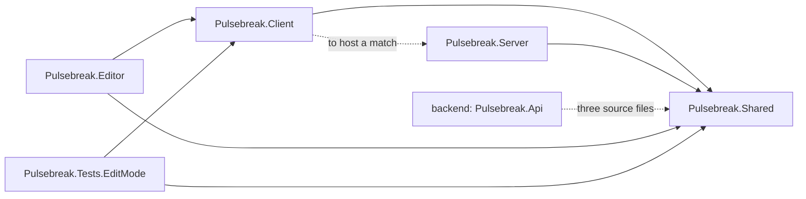
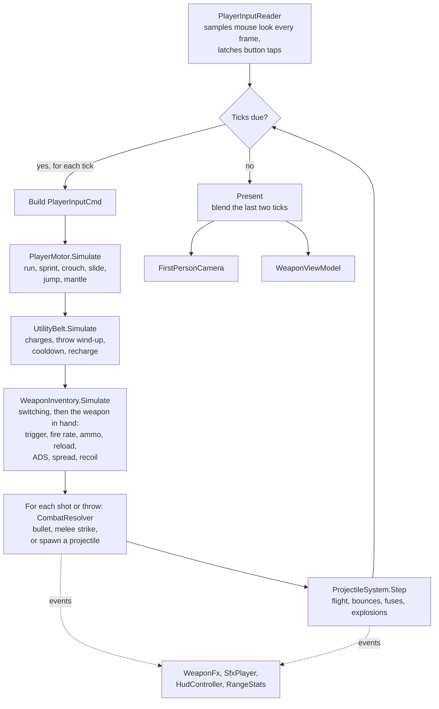
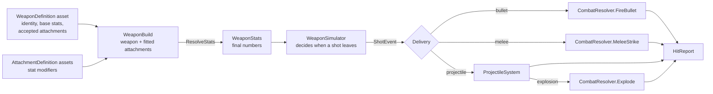
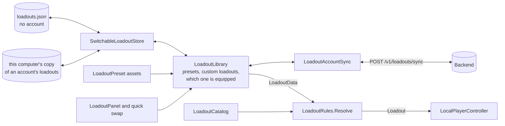
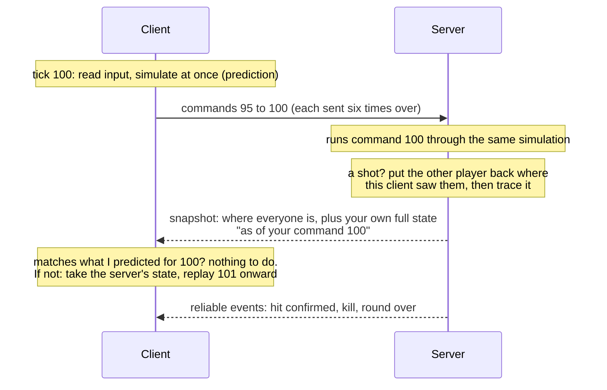
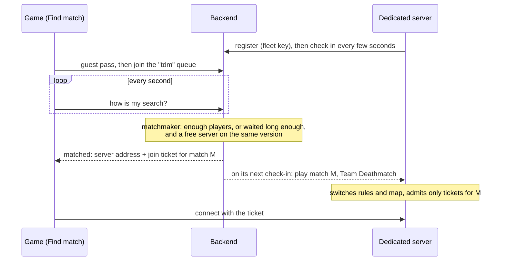
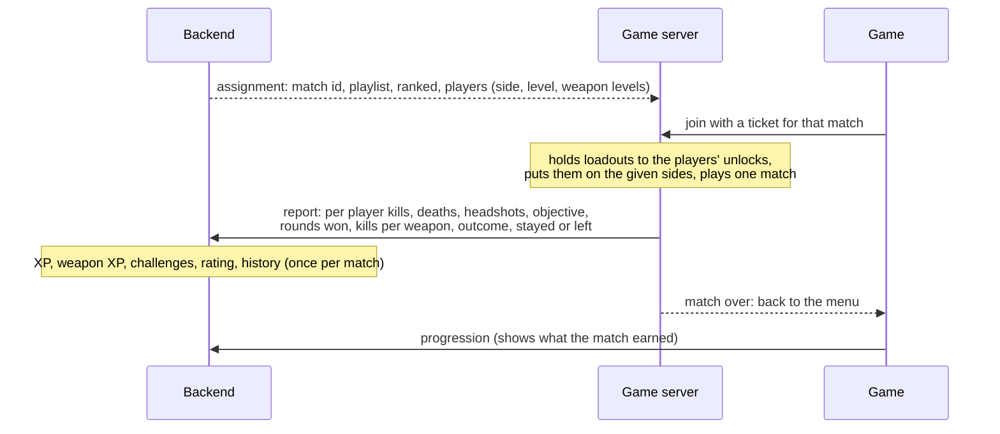
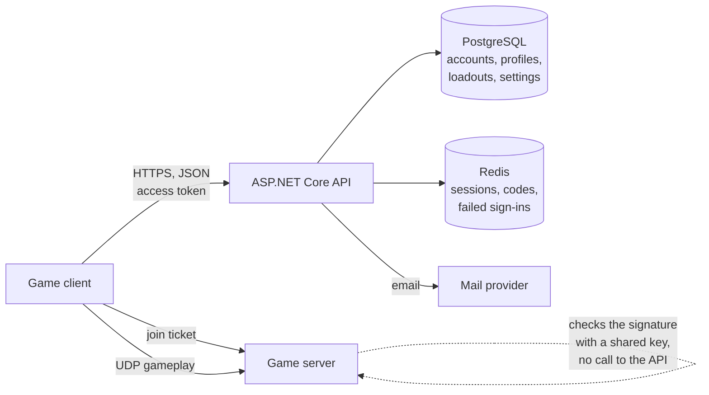

# Pulsebreak architecture

Pulsebreak (working title) is a fast, competitive multiplayer FPS for PC: tight gunplay and loadouts from modern military shooters, short rounds and snappy movement from arena shooters. This document covers the technology choices, how the repository is laid out, and how the systems connect. The phased plan is in [ROADMAP.md](ROADMAP.md).

Phases 1 to 8 exist as code today: movement, the weapon system, loadouts, a firing range to try them in, online matches on a server that owns the match, accounts on a backend that the loadouts and settings follow, every game mode with bots and matchmaking, character cosmetics, and progression with challenges and ranked play. Accounts can be switched off with one flag, `GameServices.AccountsEnabled` (they were, during Phase 5 to 7); they are on. Sections that describe later phases say so.

## Technology choices

| Area | Choice | Status |
| --- | --- | --- |
| Engine | Unity 6, URP, C# | In use |
| Input | Unity Input System | In use |
| UI | UI Toolkit (UXML + USS) | In use |
| Netcode | Written for this game: server-authoritative, over UDP | In use |
| Backend API | ASP.NET Core on .NET 10 | In use |
| Database | PostgreSQL 16, through Entity Framework Core | In use |
| Sessions, codes, counters | Redis 7 | In use; queues come with matchmaking |
| Password hashing | Argon2id | In use |
| Game servers | The game itself, started with `-batchmode -nographics -server` | Runs today; containers and a fleet come with matchmaking |

### Netcode: written for this game

The game needs a server that owns the truth, clients that predict their own movement and shooting so input feels instant, and lag compensation so a shot that was on target on your screen counts. Three libraries were considered:

| | Netcode for GameObjects | Photon Fusion 2 | Fish-Networking |
| --- | --- | --- | --- |
| Client-side prediction with rollback | No. Offers "client anticipation", which does not roll back and replay ([Unity docs](https://docs.unity3d.com/Packages/com.unity.netcode.gameobjects@2.7/manual/latency-performance.html)) | Built in | Built in |
| Lag-compensated hit detection | Not provided | Built in | A paid Pro feature ([FishNet docs](https://fish-networking.gitbook.io/docs/guides/features/lag-compensation)) |
| Cost | Free | Free tier, then priced by concurrent users | Free core, paid Pro tier |

**Decision: none of them. The netcode is part of this project.** The simulation was built from the start so that it could be rewound and replayed ([The simulation core](#the-simulation-core)), which is the hard part a library would otherwise provide. What was left to write was a transport, a wire format and the server. In return:

- there is no per-player fee and no account with a third party;
- nothing is a black box: when a shot does not register, every line that decided it is in this repository;
- the whole thing runs in a test, with a real server and real clients, on a simulated bad connection ([How it is tested](#how-it-is-tested)).

The cost is owning it. What a library would have brought and this does not yet have is listed under [Known limits](#known-limits).

### Backend: ASP.NET Core

ASP.NET Core over Node.js, for three reasons:

- **One language.** The game is C#, so code can be shared instead of written twice and kept in sync by hand. Three of the game's own files are compiled into the backend today: the stored loadout format, the rule for merging two copies of it, and the join ticket ([Shared with the game](#shared-with-the-game)).
- **What accounts need is built in.** JWT authentication, rate limiting middleware, data validation and password hashing libraries are first-party or standard.
- **Performance headroom.** Matchmaking and leaderboards are CPU-bound work where it does well.

PostgreSQL holds everything durable (accounts, profiles, loadouts, settings; later inventories, stats, match history). Redis holds everything short-lived (sessions, emailed codes, failed-login counts; later matchmaking queues and parties).

It targets .NET 10, the current long-term-support release: .NET 8 reached the end of its support in November 2026.

## Repository layout

```
pulsebreak/
├── README.md               How to open and play the current build
├── docs/
│   ├── ARCHITECTURE.md     This file
│   └── ROADMAP.md          The phased plan
├── game/                   The Unity 6 project (client and dedicated server builds)
└── backend/                The accounts API
    ├── README.md             How to run it, configure it and call it
    ├── docker-compose.yml    PostgreSQL and Redis for local development
    ├── src/Pulsebreak.Api/
    │   ├── Auth/               Password hashing, input rules, tokens, sessions, lockout, emailed codes
    │   ├── Data/               Database model and migrations
    │   ├── Email/              Sending email, and its wording
    │   ├── Endpoints/          The HTTP routes
    │   ├── Loadouts/           Storing and merging loadouts
    │   └── Program.cs          Wiring, rate limits, token checking
    └── tests/Pulsebreak.Api.Tests/   The whole API against a real PostgreSQL and Redis
```

### Inside the Unity project

```
game/
├── Packages/manifest.json
├── ProjectSettings/
└── Assets/_Project/
    ├── Shared/             Gameplay rules. Runs on client and server.
    │   ├── Simulation/       Tick constants, input commands, layers, seeded random,
    │   │                     and PlayerSimulation: one player, stepped a tick at a time
    │   ├── Movement/         Character motor, its config asset and state
    │   ├── Weapons/          Weapon and attachment assets, stats, simulator, inventory,
    │   │                     projectiles, combat resolution, catalog, validation
    │   ├── Loadouts/         Stored loadout format, rules, presets, utility items,
    │   │                     perk sets, the utility belt, catalog, validation
    │   ├── Combat/           Health, hitboxes, damage types
    │   ├── Net/              Packets, sockets (UDP and in-process), the connection,
    │   │                     and every message that crosses the wire
    │   ├── Match/            Duel rules and state, the arena as data, player health,
    │   │                     and the interfaces the server reaches the world through
    │   └── Unity/            Those interfaces implemented with Unity physics
    ├── Client/             Everything a player sees, hears or touches.
    │   ├── Controls/         Input System reader
    │   ├── Player/           Local player loop (offline and online), camera, rig assembly
    │   ├── Net/              The client's side of a match: connection, prediction,
    │   │                     interpolation; and how the other player is drawn
    │   ├── Duel/             The duel scene: main menu and account forms, hosting and joining, match HUD
    │   ├── Cosmetics/        The saved look and the Customize screen's preview stage
    │   ├── Online/           The account client, keeping loadouts and settings in step with
    │   │                     the backend, and the services that outlive a scene
    │   ├── Weapons/          First-person weapon models, tracers, projectiles, explosions
    │   ├── Audio/            Sound playback and placeholder synthesis
    │   ├── Loadouts/         The loadout library and where it is saved
    │   ├── UI/               HUD, pause menu and loadout screen logic
    │   ├── Settings/         Player settings
    │   ├── Visuals/          Prototype geometry and materials
    │   └── FiringRange/      The range: layout, targets, stats
    ├── Server/             The authority: game server, players, lag compensation
    │   ├── Modes/            The rules of each game mode
    │   ├── Bots/             Bot behaviour and navigation
    │   └── Unity/            The components that run a server inside Unity and offer it to matchmaking
    ├── Editor/             Editor tooling (Project Doctor)
    ├── Content/            Data assets: weapons, attachments, utility, perks, presets, movement
    ├── Resources/          UI layout, styles and base materials loaded by path
    ├── Rendering/          URP pipeline assets
    ├── Scenes/             Duel (the main menu and online play) and FiringRange
    └── Tests/EditMode/     Unit tests for the simulation, the netcode and the content
```

Each top-level code folder is its own assembly, and the compiler enforces the direction of dependencies:



`Shared` references nothing of ours. It cannot reach the HUD, the camera or the input devices, which is what keeps it runnable on a headless server. `Server` references only `Shared`: it knows nothing about the client and can be built without it. `Client` references `Server` for one reason, so a player can host a match from the menu. That reference is the first thing to cut if ranked play should only ever run on servers you operate.

## The simulation core

The rule everything else follows from: **gameplay advances in fixed ticks, from input commands, into plain state.**

- **Fixed ticks.** Movement and weapons step 60 times a second regardless of frame rate (`SimConstants`).
- **Input commands.** Each tick the simulation reads one `PlayerInputCmd`: move axes, view angles and a set of held buttons. It never reads the keyboard, the mouse or the clock.
- **Plain state.** `MotorState` and `WeaponState` are structs holding everything about a character and their gun. They can be copied, stored and restored. `PlayerSimulation` bundles the motor, the weapons and the utility belt of one player, and `PlayerSimState` is all of its state in one object that can be saved, compared, sent and put back.
- **Seeded randomness.** Bullet spread comes from `DeterministicRandom`, seeded by weapon and shot number, never from `UnityEngine.Random`.
- **Presentation listens, never talks back.** Camera, weapon model, audio and HUD read simulation state and subscribe to its events. Nothing in the simulation depends on them.

Those five properties are exactly what server authority and client-side prediction require: the server runs the same code on the same commands, and a client rewinds to a past state and replays its commands when the server corrects it. The firing range, a client predicting its own player and the server all step the same `PlayerSimulation`.

### One frame of the local player



`LocalPlayerController` owns this loop. The diagram shows it offline, where it is also the authority. Online the same loop runs as a prediction, described under [Networking](#networking). Position is blended between the last two ticks so motion is smooth at any frame rate, while view angles come straight from the current frame's mouse input, so aiming has no added latency.

## The weapon system

A weapon is data, and the path from an asset to a hit is the same for all forty of them:



- **`WeaponDefinition`** is one asset per weapon: an id, a class, a loadout slot, base stats, the attachments it accepts, and the proportions and sound of its placeholder model. **`WeaponCatalog`** lists them all; a weapon exists for the game once it is in the catalog.
- **`AttachmentDefinition`** is one asset per attachment: a slot and a list of stat changes such as "magazine size x1.34". Because the changes are relative, one suppressor asset fits every weapon that lists it.
- **`WeaponBuild`** is a weapon plus at most one attachment per slot. `ResolveStats` copies the base stats, applies additions and then multipliers, and clamps the result. It is the only place attachment effects become numbers.
- **`WeaponStats`** is a plain class, not a Unity object, so the simulator, the tests and later the server and backend can use it without assets.
- **`WeaponSimulator`** handles every fire mode (automatic, semi-automatic, burst, charge), both reload styles, spread, recoil and timing. It emits `ShotEvent`s and never touches physics.
- **`WeaponInventory`** holds one simulator per slot, so ammo is remembered while a weapon is put away, and times the switch between them.
- **`CombatResolver`** and **`ProjectileSystem`** turn shots into `HitReport`s: bullets that can pierce, melee sweeps, and projectiles with gravity, bounces, fuses and explosions that respect cover.

Adding a weapon or an attachment is therefore an asset and a catalog entry. Code changes only when a weapon needs a behaviour that does not exist yet.

## Loadouts

A loadout is a primary, a secondary, a melee weapon, one utility item and a perk set. It exists in two forms, and one set of rules converts between them.



- **`LoadoutData`** is the stored form: a name and nothing but ids. It holds no asset references, so it can be written to a file, sent to a server or kept in a database, and still be read after content has changed. A `LoadoutCollection` wraps a player's loadouts with a format version, the id of the equipped one, and a record of recent deletions.
- **`Loadout`** is the playable form: real `WeaponBuild`s, `UtilityDefinition`s and a `PerkSetDefinition`.
- **`LoadoutRules`** is the only way from one to the other. `Resolve` never fails: an unknown weapon, a weapon in the wrong slot, an attachment that does not fit, the same utility item twice or a missing perk set is replaced with a default and noted. The game server runs the same function on every loadout a client sends, so a client cannot equip something illegal by editing its save or its packets.
- **`LoadoutLibrary`** is what the UI talks to: create, rename, replace, delete, equip. It keeps presets read-only, limits custom loadouts to ten, sanitises every edit, and saves after every change. It lives for as long as the game runs (`GameServices`), not per scene.
- **`ILoadoutStore`** is where saving happens. `LocalFileLoadoutStore` writes JSON to the save folder, swapping the file in whole so a crash cannot leave half of one, and sets an unreadable file aside instead of overwriting it.

### Following the account

Phase 3 made loadouts local first, with sync in mind. Phase 5 added the sync, and the format needed only two additions:

- every loadout already had a permanent id and the time it was last changed;
- the collection gained the time the equipped choice was made, and a list of recent deletions. Without the deletions, a loadout deleted on one computer would come straight back from another that still had it.

**One merge rule, in both places.** `LoadoutSync.Merge` decides, for each loadout and for the equipped choice, which copy wins: the newest change. A deletion counts as a change. It is the same source file in the game and in the backend, so the two cannot disagree. Merging is safe to repeat, which makes a retried request harmless. Each change is stamped later than the one it replaces even if the clock stands still, and the backend treats a time from the future as "now", so a computer with a wrong clock cannot win every argument.

**What happens on signing in.** `LoadoutAccountSync` points the library at this computer's copy of that account's loadouts, so they are there at once even offline. Loadouts made without an account move onto the first account to sign in. Then everything goes to the backend and the merged result comes back. After that, every change is sent a moment later. If the backend cannot be reached, changes stay on this computer and go next time. Signing out goes back to the no-account file.

**The backend checks shape, the game server checks legality.** The backend refuses malformed or oversized loadouts but does not know what a weapon is. The game server runs `LoadoutRules` on whatever a player brings to a match, against the game's own content, as it did before accounts existed.

### Utility items and perk sets

- A **`UtilityDefinition`** is a throwable: how many are carried, the wind-up and cooldown of a throw, and the projectile stats of the thrown object. Those are the same stats weapons use, so a thrown grenade and a launched one go through the same `ProjectileSystem`.
- **`UtilityBelt`** simulates the two slots per tick, like `WeaponSimulator` does a weapon. While a throw is winding up the weapon in hand cannot fire.
- A **`PerkSetDefinition`** is a bundle of passive effects: stat modifiers applied to every weapon after its attachments, a movement speed multiplier, and utility bonuses.

### Where each requirement lives

| Requirement | Class | Notes |
| --- | --- | --- |
| Sprint, slide, crouch, jump, mantle | `PlayerMotor` | Tuned by a `MovementConfig` asset. Lean was in the brief and was built, then removed at your request |
| ADS, recoil patterns, spread, fire modes, reload | `WeaponSimulator` | Runs on `WeaponStats` |
| Hitscan and projectile weapons | `CombatResolver`, `ProjectileSystem` | Chosen per weapon by its `ballistics` stat |
| Damage falloff, headshot multipliers | `DamageCalculator`, `Hitbox` | One function used for feedback and authority. Dealt damage is rounded to a multiple of five (`DamageCalculator.Standardize`) |
| Attachments | `AttachmentDefinition`, `WeaponBuild` | Sights, barrels, magazines, grips, stocks, lasers |
| Weapon switching | `WeaponInventory` | Primary, secondary and melee slots |
| Premade default loadouts | `LoadoutPreset`, `LoadoutCatalog` | Six ship with the game |
| Create, edit, rename, save custom loadouts | `LoadoutLibrary`, `LoadoutPanel` | Saved through `ILoadoutStore` |
| One utility item, one perk set | `UtilityBelt`, `UtilityDefinition`, `PerkSetDefinition` | |
| Stat bars that compare weapons | `WeaponRatings`, `WeaponRatingScale` | Each bar runs from the weakest to the strongest weapon for the same slot |
| Loadouts saved to the account and synced | `LoadoutAccountSync`, `LoadoutSync`, backend `LoadoutService` | Newest change wins, deletions included |
| Quick-swap loadouts between rounds | `HudController` quick swap, `ClientSession.SetLoadout` | In a match the server applies it at the next spawn |
| Hit markers, damage numbers, crosshair, optics | `HudController` | Damage numbers toggle in the pause menu |
| New content without code | Definition assets and catalogs | `LoadoutValidator` checks all of it |
| Server-authoritative play | `GameServer` | Clients send inputs and nothing else that counts |
| Client-side prediction | `ClientSession`, `PlayerSimulation` | Rollback and replay on disagreement |
| Lag compensation (hit rewind) | `LagCompensator` | Capped at 0.3 s |
| Interpolation of other players | `ClientSession.TryGetView`, `RemotePlayerView` | |
| Server checks hits, speed, fire rate, ammo | `GameServer` | By running the simulation itself |
| 1v1, 2v2, 3v3, 5v5 and free-for-all | `GameMode`, `MatchSettings` | Team size and player count are settings |
| Duel (best of five), Team Deathmatch, Elimination, Domination, Hardpoint, Free-for-All, Gun Game | `Server/Modes` | |
| Bots for practice and to fill matches | `BotBrain`, `NavGrid`, `GameServer.BalanceBots` | Three skill levels |
| Private lobbies with custom settings | `DuelUi` host options, `MatchSettings` | Map, mode, size, win limit, bots |
| Casual matchmaking | backend `MatchmakingService`, `MatchmakingClient`, `FleetAgent` | Guests welcome |
| Ranked, levels, unlocks, challenges | `Shared/Progression`, backend `ProgressionService`, `UnlockRules` | Ranked: Duel and Elimination 3v3, verified accounts |
| Kill feed, health, scores, clock, zones, scoreboard | `DuelUi`, `ZoneMarkers` | |
| Character customization, cosmetics only | `CosmeticCatalog`, `CustomizeScreen`, `CharacterLookView` | All free for now; never affects play |

## Networking

One process is the **server**. It holds the only copy of the match that counts. Each player's game is a **client**: it sends what its player is pressing and draws what the server says happened. A client is never asked what it hit, where it is or how much ammunition it has.



### The pieces

| Layer | Class | Job |
| --- | --- | --- |
| Socket | `INetSocket`: `UdpSocket`, `MemoryNetwork`, `ConditionedSocket` | Send and receive datagrams. The in-process and bad-connection versions exist so the rest can be tested |
| Connection | `NetConnection` | Numbers packets and acknowledges them, measures the round trip, and carries two kinds of message: unreliable (sent once) and reliable (resent until acknowledged, delivered in order) |
| Wire format | `NetMessages`, `NetWriter`, `NetReader` | Every message, written and read in one place. The reader never trusts its input |
| Server | `GameServer`, `ServerPlayer`, `LagCompensator` | The authority |
| Rules | `GameMode` and its kinds in `Server/Modes`, `MatchSettings`, `MatchState`, `ArenaLayout` | What the match is: teams, spawns, scoring, when it ends |
| Bots | `BotBrain`, `NavGrid` in `Server/Bots` | Players without a connection |
| Client | `ClientSession` | Connection, prediction, interpolation, and events for the HUD |
| World | `IGameWorld`, `ICharacterBody` | How the server reaches physics. `UnityGameWorld` in the game, a stand-in in tests |

### Joining

A client asks to join; the server answers with a number worked out from the client's address; the client sends it back. Only then does the server create anything for that client. The reply to a request is never larger than the request, and an unanswered request costs the server no memory, so the handshake cannot be used to flood a third party or to exhaust the server with made-up addresses. Every packet after that carries the token the two agreed on.

### Prediction

Each tick the client turns its input into a `PlayerInputCmd`, rounds it to exactly what will survive the trip (`NetMessages.Quantize`), simulates it immediately and sends it. Each packet carries the last six commands, so a lost packet costs nothing.

The server runs each command once through the same `PlayerSimulation` and includes the result in its next snapshot to that player, together with the number of the command it had reached. The client kept its own state after every command. If the two agree, nothing happens. If they differ, the client takes the server's state, replays the commands it has sent since, silently, and slides the view to the corrected position over about a tenth of a second.

In the test harness, with client and server stepping identical code, the count of corrections after a round has started is zero, on a clean connection and at 200 ms with 5% packet loss. In Unity it will not be exactly zero: two machines do not always round a float the same way, and the position check allows 2 mm before it calls something a disagreement. The match HUD shows a running count (F3).

### Seeing the other player

Snapshots arrive 60 times a second. The other player is drawn slightly in the past, about two snapshots back and further when the connection is uneven, so there are nearly always two known positions to blend between. If nothing newer has arrived the body carries on in a straight line for up to a tenth of a second rather than freeze.

### Lag compensation

Because the other player is drawn in the past, a client aiming straight at them is aiming at where they were. Each command therefore carries the server tick its player was looking at. When that command fires an instant shot, `LagCompensator` puts every other body back where it was at that tick, the server traces the shot, and puts them forward again. The rewind is capped at 0.3 s, which bounds the advantage a very poor connection can get.

Measured in the harness, firing at a strafing target at about 170 ms round trip: 39 of 39 shots hit with the rewind, 4 of 39 without it.

Projectiles are not rewound. They are launched when the server runs the command, fly in server time, and everyone is shown the same flight.

### What the server refuses

There is no separate anti-cheat pass; the server simply does not ask the client for anything it could lie about.

| A modified client tries to | What happens |
| --- | --- |
| Move faster | The server moves the player itself, from the buttons held |
| Run its game faster than real time | Each player earns one command per server tick, with a small allowance saved up for hiccups. Extra commands wait, then are dropped. Tested: a client running at double speed travels no further |
| Fire faster, or without ammunition | The server runs the weapon itself |
| Claim a hit | Clients do not report hits. The server traces every shot, with spread drawn from the same seed |
| Rewind further than it should | The view tick is clamped to the last 0.3 s |
| Equip something it should not have | `LoadoutRules` replaces it, as it would on loading a save |
| Send malformed or hostile packets | `NetReader` fails closed: a bad length, a number that is not a number or a truncated message is dropped. Tested with several thousand random packets and messages |
| Learn the opponent's ammunition or cooldowns | Only a player's own snapshot carries their full state |

What this does not stop is a client that reads its own memory to see through walls or aim for the player. That needs a different kind of defence and is noted in the roadmap.

### Game modes

The server knows how to run players; the rules of the match belong to a `GameMode`, created from the `MatchSettings` the server is given. Every mode follows the same outline (warm-up, a short wait for latecomers once there are enough players, countdown, play, round end, match end, a fresh match) and fills in what differs:

| Class | Modes | What it decides |
| --- | --- | --- |
| `RoundMode` | Duel, Elimination | Rounds with no respawns. A round ends when a side is wiped out, or on time (more players left, then more health). Sides swap ends each round |
| `RespawnMode` | Team Deathmatch, Free-for-All | Respawns after a delay; first to the score limit, or ahead when time runs out |
| `ZoneMode` | Domination, Hardpoint | Capture zones from the map. Domination: three zones, taken faster with more players, pushed back before they change hands, a point a second each. Hardpoint: one zone at a time, moving on a timer, a point a second for a lone holder |
| `GunGameMode` | Gun Game | A ladder of weapons. A kill rearms the killer on the spot; the knife sets the victim back |

Teams are 0 and 1; a mode without teams gives everyone `Teams.None` and names a player as the winner instead of a team. Teammates cannot hurt each other (`PlayerVitals.CanBeHurtBy` asks the mode), and shots pass through them. A respawn picks the spot furthest from living enemies and avoids any an enemy can see. The whole `MatchState` is sent whenever it changes; zones and each player's kills, deaths and score ride in every snapshot.

Gun Game changes a player's weapons without killing them. Both ends restrict a loadout the same way (`MatchLoadouts`: a mask of usable slots), and a rearm counts like a spawn, so the client drops predictions made with the old weapon and takes the server's next word on the new one.

The countdown is the one place prediction needs care. The server ignores movement and fire until the countdown ends, and a command sent now arrives a little later, so the client releases its own controls when a command sent *now* would arrive after the countdown, not when its own screen says zero. Everyone starts moving at the same server tick whatever their ping.

A loadout change sent mid-life is checked and held, and applied when the server next places that player.

### Bots

A bot is a `ServerPlayer` with no connection and a `BotBrain`. Each tick the brain produces an input command, and the server runs it through exactly the same simulation as a person's, so a bot cannot do anything a player cannot. The server adds bots when the rules ask for them and at least one person is playing, and drops one (from the bigger team) whenever a person needs the place.

- **Navigation.** `NavGrid` cuts the map into half-metre cells from the same block list the collision is built from: the height a player would stand at, or blocked if a body would not fit. Neighbouring cells connect as a walk, a climb (jump and mantle, up to 1.45 m) or a drop. A* finds a path, and the path is straightened wherever a level straight walk works.
- **Seeing.** Every few ticks: enemies inside its field of view (or very close, or who just hurt it), with a clear line of sight.
- **Aiming.** It turns towards the target at a limited rate, leads moving targets a little, and adds an error that shrinks the longer it tracks. It fires when its crosshair is on the body (a weaker bot accepts near), in bursts, pulling against recoil.
- **Moving.** It closes to its weapon's preferred range, then strafes. With nobody to fight it goes for the objective (a zone that is not its team's, the active hardpoint) or the nearest enemy. If it is stuck it jumps, picks a new path, and in the end a new goal.

Skill (easy, normal, hard) sets reaction time, aim error, turn rate, field of view and recoil control. Measured in the test harness, a 3v3 of normal bots plays a match to the score limit with nobody stuck or falling out, and a hard bot finds and beats a player standing still.

### Matchmaking



The backend keeps queues, tickets and the fleet in Redis, and runs the matchmaker once a second under a lock, so several API processes can share the work. The playlists (one per mode, with its size and the fewest people it starts with) are a shared source file, `Shared/Match/Playlists.cs`, compiled into the backend. A matchmade server is given a match id, and checks it in each join ticket, so nobody can walk into a match they were not sent to. On the game side, `MatchmakingClient` does the queueing and `FleetAgent` is the dedicated server's side.

### One process, two worlds

When a player hosts from the menu, a server and a client run in the same process and their bodies must never touch. The server's capsules and hitboxes live on their own two physics layers (`GameLayers.ServerCharacter`, `ServerHitbox`), the level's collision is shared, and server code switches the masks while it runs. The hosting player's client still talks to its own server through a UDP socket and is predicted and corrected like any other.

### How it is tested

`Shared`, `Server` and `ClientSession` never touch a scene, so the tests run a real `GameServer` and real `ClientSession`s in one process, joined by `MemoryNetwork`, with `ConditionedSocket` adding delay, jitter, loss and duplicates. That covers connecting, prediction on good and bad connections, lag compensation with and without the rewind, a best-of-five played through, round timers, projectiles and utility, loadout checks, a speed hack, random and hostile packets, leaving, timeouts and a full server. One test does the same over real UDP sockets on the loopback address.

The modes have their own: bots filling and giving up places, twelve players in one snapshot, friendly fire, Team Deathmatch and Free-for-All to their limits, Elimination rounds, Gun Game's rearming without prediction errors, capturing and contesting zones, Hardpoint's rotation, a matchmade server refusing tickets for other matches, paths between every spawn on every map, and bots playing whole matches. An end-to-end test runs the game's matchmaking client as two guests against the real backend and ends with both in the server it chose.

The tests that need the stand-in physics world are not in the Unity project, because that world replaces `UnityEngine`. The ones in `Tests/EditMode` cover the layers below: packet buffers, the connection (including 40% loss and sequence wrap-around), every message, and the arena's symmetry and spawn points.

### Known limits

- **No encryption.** Game traffic is not encrypted. A server given the backend's ticket key knows who each player is, but the packets after that are protected only by the connection token. Fine on a LAN and for testing; before public play the traffic should be encrypted, with a key handed out alongside the ticket.
- **No NAT traversal or relay.** To host a private match over the internet the host forwards a UDP port. Matchmade games run on dedicated servers on public addresses and do not have this problem.
- **A fixed fleet.** Dedicated servers are started by hand and offered to matchmaking; nothing starts more when they are all busy yet.
- **IPv4 only.**
- **Snapshots are sent whole**, sixty times a second: about 0.6 KB with twelve players, inside one packet. Delta compression and a lower rate would cut that for larger matches.
- **A player's own projectiles appear when the server launches them**, one round trip after the trigger. The shot sound and recoil are immediate.
- **Players pass through each other.** It keeps prediction independent of where the opponent is.
- **Sound has no position yet.** Other players' shots are only quieter with distance.

## Cosmetics

A player's look is a `CharacterLook`: the id of the item chosen for each slot (suit colour, trim colour, pattern, headgear, visor, back) and their weapon skins (one for every weapon, plus any weapon with its own). The items are defined in code in `CosmeticCatalog` (`Shared/Cosmetics`), so the server can check a look without loading any content, and `LookRules.Sanitize` turns anything unknown into a default.

| Piece | Where | Job |
| --- | --- | --- |
| Catalog and rules | `CosmeticCatalog`, `CharacterLook`, `LookRules` (Shared) | What exists, what a legal look is, random looks for bots |
| Saved look | `CosmeticsLibrary` (Client/Cosmetics) | `cosmetics.json` beside the loadouts; raises `Changed` |
| On the wire | `NetMessages.WriteLook`/`ReadLook` | Each slot as its item's position in the catalog (one byte), then the per-weapon skins; at most about a kilobyte. Sent in the hello, in every `PlayerInfo`, and in a `Look` message when it changes |
| Drawing a character | `CharacterLookView`, `LookMaterials` (Client/Visuals) | Materials on the body parts, headgear and back items from simple shapes on anchors that follow the head and torso, patterns drawn into small textures in code |
| Weapon skins | `ViewModelBuilder` (first person), `RemotePlayerView` (others) | The skin's materials in place of the weapon's own colours |
| The screen | `CustomizeScreen` (Client/UI), `CharacterPreview` | Categories, item tiles, and a character on a stage far below the level filmed into a render texture |

Catalog lists are append-only, because the wire format sends positions: add new items at the end and retire old ones by hiding them. The server passes a player's new look on at most twice a second, always ending on the latest.

Nothing cosmetic has a collider. The hitboxes are the same six parts for everyone, so what a player wears cannot make them harder to hit; team-coloured shoulder pads are drawn over every outfit so sides stay readable.

## Progression and ranked

Only matchmade matches count, because only a matchmade server's word is trusted: it was given the match by the backend, it checked every player's ticket, and it ran the match itself.



| Piece | Where | Job |
| --- | --- | --- |
| The numbers | `Shared/Progression/Progression.cs` | Level and weapon level curves, match XP, rank tiers and the Elo change; the report and assignment formats. Compiled into the backend too |
| Unlocks | `UnlockRules`, `PlayerUnlocks` (Shared/Loadouts) | What a player may carry; swaps anything locked for the starter. Used by the server in matchmade matches and by the loadout screen for its badges |
| Match stats | `ServerPlayer`, `GameMode.OnKill`, `ZoneMode`, `RoundMode` | Kills, headshots, kills per weapon, objective points, rounds won |
| The report | `GameServer.MatchFinished`, `FleetAgent` | Built when the match is decided, with anyone who left as a loss; posted to the backend with retries |
| One match per session | `GameMode` (match end), `GameServer.EndSession` | Sends everyone home with a "match over" reason; the server is then free for matchmaking |
| Awarding | backend `ProgressionService` | XP, weapon XP, challenges, ratings and history in one transaction; a second report of the same match changes nothing |
| Challenges | backend `Challenges` | Pools of daily and weekly challenges; each player's three per period are picked from a hash of their id and the date |
| Ranked matching | backend `MatchmakingService.MatchRankedAsync` | Oldest first, the closest-rated others within a window that widens with waiting; full matches only; snake-draft teams |
| In the game | `ProgressionCache`, `ProgressScreen`, `DuelUi` profile and Ranked box, `LoadoutPanel` badges | Shows what the backend says |

Ratings are Elo against the other side's average, with a larger step during the five placement matches and a smaller one after thirty. A ranked no-show (sent by the matchmaker but never reported) loses.

## Accounts and the backend

> **Switched off in the game for now.** `GameServices.AccountsEnabled` is false: the menu has no sign-in, no request goes to the backend, and loadouts and settings stay on the computer. Everything below still exists and is tested; setting the flag to true brings it back. The plan is to make accounts required when they return.



The backend's [README](../backend/README.md) lists every route, setting and safeguard. In outline:

- **Accounts.** Sign-up with email, username and password. Signing in takes either the email or the username. A six-digit code and a link are emailed to verify the address. Forgotten passwords are reset with an emailed code; changing or resetting a password signs every other device out at once.
- **Passwords** are stored only as Argon2id hashes, with the cost recorded in each hash so it can be raised later without breaking anyone's sign-in.
- **Sessions.** A 15-minute access token, and a 30-day refresh token that works once and is replaced on every use. A refresh token used twice means it was copied, and ends the session. The game shares one refresh between requests that need it at the same moment, so it never trips this itself.
- **Guessing.** Per-account lockout that doubles, codes that die after five wrong guesses, per-address request limits, and the same answer (in about the same time) for a wrong password as for an account that does not exist.
- **Player data.** A profile (level, XP, currency, rating: all at their starting values until progression and ranked arrive), loadouts and settings. Settings follow the same newest-wins rule as loadouts.
- **Join tickets.** A signed note from the backend saying "this connection is this account". A game server given the same key checks it by itself and uses the account's name; without a valid ticket it turns the player away with a reason. A ticket for ranked play is only issued to an account with a verified email, and a server started with `-ranked` admits no other kind. That is how "verify your email before ranked" is enforced end to end. Servers without the key (a match hosted from the menu) still admit anyone.

### In the game

`AccountClient` is the game's side of all of this, with no Unity in it beyond JSON, so the tests run it against the real API. `GameServices` owns it, the loadout library and their sync for as long as the game runs, whichever scene is open. Sign-ins are kept per profile: the Editor has its own, so the Editor and a build on the same computer can be two different players.

The refresh token is kept in a file in the user's application data folder, as a browser keeps its cookies. Anyone who copies that file can be that player until the session is ended.

### Shared with the game

| File | In the game | In the backend |
| --- | --- | --- |
| `Shared/Loadouts/LoadoutData.cs` | The save format | The format of `/v1/loadouts` |
| `Shared/Loadouts/LoadoutSync.cs` | Merging what comes back | Merging what arrives |
| `Shared/Net/GameTicket.cs` | Game servers check tickets | The API writes them |

These files may use nothing but `System`, so they compile in both.

### How it is tested

- The backend's own tests (61) start the whole API in memory against a real PostgreSQL and Redis, each class in a fresh database built by the migrations: sign-up rules, races for one username, lockout timings, refresh-token reuse, tokens cut off after a password reset, codes that stop working, loadout merges between two devices, settings, tickets, rate limits, and requests that are malformed or too large.
- The game's tests run the game's own `AccountClient` and `LoadoutAccountSync` against the real API as a separate process, then take the ticket it issues to a real `GameServer`: sign up, verify by the emailed code, stay signed in across a restart, share one token refresh between five requests, be signed out when the password is reset elsewhere, carry loadouts (and a deletion) from one computer to another, and join a match under the account's name.

### Still to come

- **Matchmaking** (Phase 6): queues in Redis, a matchmaker that groups players by rating and ping, and game servers allocated on demand, which will issue tickets bound to a specific server.
- **Results** (Phases 6 and 7): game servers report match outcomes to the API with their own credential, and the API awards XP and updates stats. Clients never report results.
- **Social** (Phase 10): friends, parties, invites, block and report.

## Project conventions

- Data that designers tune lives in ScriptableObject assets under `Content/`, never as constants in code.
- Physics layers are referenced by index through `GameLayers`: `Character` (8) for movement capsules, `Hitbox` (9) for per-body-part damage colliders, and `ServerCharacter` (10) and `ServerHitbox` (11) for the server's copies. Bullets hit the world and hitboxes; movement collides with the world.
- Units are metres, seconds and degrees.
- Levels, props and weapon models are built from code (`GreyboxKit`, `RangeLayout`, `ArenaLayout`, `ViewModelBuilder`) because there is no art yet. They are stand-ins for authored scenes and prefabs, which replace them as content arrives.
